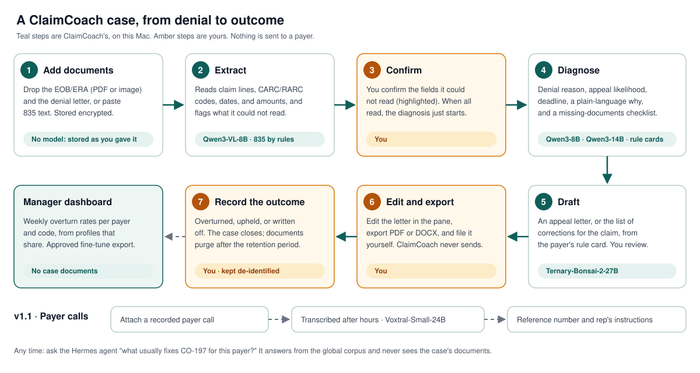

<p align="center">
  
</p>

# ClaimCoach developer guide

How ClaimCoach runs, from a clean Mac to the everyday start, and a reference for its models, REST
API, database, storage, and uploads. For what ClaimCoach is and who it is for, see
[README.md](README.md). Product: [PRD.md](PRD.md). Backlog: [SPECS.md](SPECS.md). Operations:
[docs/runbooks/](docs/runbooks/README.md).

- [App flows](#app-flows)
- [Models](#models)
- [Install (first run)](#install-first-run)
- [Start (every day)](#start-every-day)
- [Configuration](#configuration)
- [REST API](#rest-api)
- [Database schema](#database-schema)
- [Corpus and storage](#corpus-and-storage)
- [Uploads](#uploads)
- [Develop](#develop)
- [Hermes bundle](#hermes-bundle)
- [Claude Code tooling](#claude-code-tooling)
- [Troubleshooting](#troubleshooting)

## App flows

ClaimCoach is one Hermes Desktop plugin package with three halves: the desktop pane
(`plugin/desktop/plugin.js`), the gateway routes (`plugin/dashboard/plugin_api.py`), and the agent
tools (`plugin/__init__.py`). Heavy work runs in an app-owned **worker** on `127.0.0.1:18200`
([ADR-0001](docs/adr/0001-worker-sidecar.md)), which starts local model servers on
`127.0.0.1:18201`–`18219`.

**For stakeholders: what stays on the Mac.** Case documents go from the pane to the worker and the
local models only. The Hermes chat agent, which may run on a cloud model, gets case IDs, codes,
payer names, and redacted summaries, never a document.


**For billers: a case from upload to outcome.** Each step names the local model that does it. Add
the EOB, ERA, or denial letter as a PDF or image, or paste 835 text, which is read by rules, not a
model. When every field
was read, the diagnosis starts on its own; otherwise you confirm the unreadable fields first. The
case then recommends an appeal or a corrected claim (a fixed table decides, not the model), and
you can ask for either draft. A person reviews every draft; nothing is sent to a payer. A recorded
payer call is transcribed after hours, so its reference number and the rep's instructions land in
the case. `retention_days` (90 by default) after a case closes, its source documents are purged;
the outcome stays, de-identified. A profile that opts in (`share_outcome_stats`) adds it to the
manager's weekly summary and to the fine-tune export, which a manager approves each time.



**For developers: one request.** The pane calls `ctx.rest`; Hermes mounts `plugin_api.py` at
`/api/plugins/claimcoach/`; the gateway proxies to the worker with the per-launch token. A long
job answers at once with a `job_id`; while it runs, the gateway long-polls the worker's
`/jobs/{job_id}/events` and publishes each event to the pane as `plugin.claimcoach.case.progress`.


**Editing the diagrams.** They follow
[diagram-design](https://github.com/cathrynlavery/diagram-design): hairline nodes with a type tag,
a name, and a mono sublabel; orthogonal connectors with rounded elbows on a 4px grid; uppercase
label chips; a legend strip; at most 9 nodes, 12 connectors, and 2 accent elements per diagram.
The request diagram is a sequence diagram, so it follows diagram-design's sequence type instead:
lifeline heads without a tag, plain mono message labels, solid calls, dashed returns, an open head
for an event, and one `LOOP` frame with its guard.
The canvas is transparent. Colors are the tokens in [docs/assets/theme.css](docs/assets/theme.css):
each SVG copies the tokens it uses, is dark by default (`class="dark"` on the root), and switches
to the light values on a page that prefers a light color scheme. Every text is measured against
its box, chip, or tag, so a label that would run past its border fails `make check`
(`tests/test_us_13_6_*` to `test_us_13_8_*`).

## Models

ClaimCoach reads weights in place from `MODELS_HOME` (default `~/Models`) and never copies them.
Each role is one entry in `models.yaml` (defaults: `plugin/claimcoach/models/models.default.yaml`).
A role's server starts on first use, is health-checked, and unloads after `idle_timeout_s` (600 s).
The memory guard never keeps two models of 14B or more loaded at once, and transcription runs only
when nothing else is loaded. Roles on the same port share one server.

| Role | Model folder in `MODELS_HOME` | Source | Venv | Port | Tier | What ClaimCoach uses it for |
| --- | --- | --- | --- | --- | --- | --- |
| `extraction` | `Qwen3-VL-8B-Instruct-4bit` | `mlx-community/Qwen3-VL-8B-Instruct-4bit` | `mlx-vlm` | 18201 | 8B | Reads EOB/ERA PDF pages, images, and letters into structured case fields (US-5.2) |
| `phi_detection` | `Qwen3-8B-4bit` | `mlx-community/Qwen3-8B-4bit` | `mlx-lm` | 18202 | 8B | Finds PHI spans (with regex validators) to redact logs and agent tool results; the fine-tune export is checked with the regex validators (US-3.1) |
| `classification` | `Qwen3-8B-4bit` | `mlx-community/Qwen3-8B-4bit` | `mlx-lm` | 18202 | 8B | Classifies the denial reason and the appeal likelihood (US-6.1) |
| `embedding` | `Qwen3-Embedding-8B-4bit-DWQ` | `mlx-community/Qwen3-Embedding-8B-4bit-DWQ` | `mlx-lm` | 18203 | 8B | Embeds the corpus into each scope's vector index at import and reindex (US-4.1, US-4.3) |
| `explanation` | `Qwen3-14B-4bit` | `mlx-community/Qwen3-14B-4bit` | `mlx-lm` | 18205 | 14B | Writes the plain-language explanation and the missing-documentation checklist (US-6.2) |
| `drafting` | `Ternary-Bonsai-2-27B-MTPLX-Optimized-Speed` | `Youssofal/Ternary-Bonsai-2-27B-MTPLX-Optimized-Speed` | `mtplx` | 18206 | 27B | Drafts the appeal letter (US-7.1) and the corrected claim (US-7.4) |
| `transcription` | `Voxtral-Small-24B-2507-4bit` | `mlx-community/Voxtral-Small-24B-2507-4bit` | `mlx-vlm` | 18207 | 24B | Transcribes recorded payer calls in the after-hours window (US-11.1) |

- There is no reranker. US-14.1 removed it and its local conversion: the diagnosis and the drafts
  read rule cards, codes, and templates by exact key, which similarity search could get wrong.
  An old `models.yaml` that still lists `rerank` loads without it.
- These folders are the only ones ClaimCoach needs. Other folders in `~/Models` belong to other
  apps and are never read.
- Venvs live in `MODELS_HOME/.venvs/`. ClaimCoach does not create `mlx-lm`, `mlx-vlm`, or `mtplx`;
  `make doctor` and `make models-check` report a missing one. The worker's own venv is
  `MODELS_HOME/.venvs/claimcoach` (`make worker-venv`).
- Peak memory is about 22–28 GB with models loaded in sequence (PRD §8).

## Install (first run)

Prerequisites: an Apple-silicon Mac, Hermes Desktop with Hermes Agent 0.22.5 or later (`hermes` on
the `PATH`), `uv`, Node.js 22.15 or later with `npm`, `openspec` (for delivery), and `curl` and
`lsof`. The model venvs must exist in `MODELS_HOME/.venvs/` with what each role runs: `mlx-lm` with
`mlx-lm` and `huggingface_hub` (it also runs the downloads), `mlx-vlm` with
`mlx-vlm` and `mlx-audio`, and `mtplx`. `make models-check` only sees whether a venv's Python
exists; see [model-download-convert](docs/runbooks/model-download-convert.md) for the packages.

1. Install the dev dependencies (uv and npm) and the pre-commit hook:

   ```bash
   make install
   ```

2. Check tools, venvs, `MODELS_HOME`, the plugin link, and the worker. It installs nothing, but
   writes the default `models.yaml` if there is none yet:

   ```bash
   make doctor
   ```

3. Create the worker venv (Python 3.12) at `MODELS_HOME/.venvs/claimcoach`:

   ```bash
   make worker-venv
   ```

4. Write the default `models.yaml` to the data dir (it never overwrites an edited copy), then list
   each role's weights and venv:

   ```bash
   make models-init
   ```

   ```bash
   make models-check
   ```

5. Start the worker. Downloads and corpus imports go through it. Model servers start only on first
   use, so missing weights don't stop it:

   ```bash
   make start
   ```

6. Download each role that `make models-check` shows as `missing`. Downloads run only with
   `CONFIRM=yes`, and Claude Code's project settings deny them to agents. Each one runs in the
   background; `make models-status` shows `acquire: downloading` until it ends:

   ```bash
   make models-download ROLE=extraction CONFIRM=yes
   ```

7. Link the package into Hermes, enable the Python half, and restart the gateway:

   ```bash
   make plugin-install
   ```

8. Enable the desktop half: Hermes Desktop → **Capabilities → Plugins** → **Rescan** → switch on
   **ClaimCoach**.

9. Load the global corpus (rule cards, codes, letter templates) from a local bundle file. The
   `embedding` model must be downloaded first. The settings page's **Import corpus** does the same
   with a preview:

   ```bash
   make corpus-import FILE=rules.yaml
   ```

10. Check the worker's health and the models:

    ```bash
    make worker-health
    ```

    ```bash
    make models-status
    ```

Every role reports `unloaded` until its first use. Open the **ClaimCoach** pane and drop a denial
document to create the first case. Details: [install-enable](docs/runbooks/install-enable.md),
[model-download-convert](docs/runbooks/model-download-convert.md).

## Start (every day)

Once ClaimCoach is installed, start the worker; it waits until `/health` answers with a new token:

```bash
make start
```

See each model server's state (`unloaded`, `queued`, `starting`, `ready`, `unhealthy`,
`stopping`):

```bash
make models-status
```

Stop the worker at the end of the day. It stops every model server it started:

```bash
make stop
```

Model servers start on first use, so the first extraction or draft of the day waits for its model
to load. To warm one up first, run `make models-load ROLE=drafting`. After a `git pull`, follow
[upgrade](docs/runbooks/upgrade.md): stop the worker, reinstall, restart the gateway and the
worker, and **Rescan** in Hermes Desktop, which runs its own copy of `plugin.js`. Details:
[worker-start-stop-health](docs/runbooks/worker-start-stop-health.md).

## Configuration

### Plugin settings

Set in Hermes Desktop's settings form for ClaimCoach (`plugins.entries.claimcoach.settings`).
`plugin/plugin.yaml`'s `config_schema` mirrors `ClaimCoachSettings` (`plugin/claimcoach/settings.py`),
and a test fails when they drift. The weights folder is not a setting: settings belong to one
profile, and the worker every profile shares reads `MODELS_HOME` (US-14.2). A `models_home` value
saved by an older version is ignored and leaves the other settings as they are.

| Setting | Default | Meaning |
| --- | --- | --- |
| `retention_days` | `90` | Days after a case closes before its source documents are purged. Also on the settings page. |
| `richer_agent_access` | `false` | Reserved for a local Hermes model; shown in the statusbar. Agent tool results stay redacted. |
| `share_outcome_stats` | `false` | Shares this profile's de-identified outcomes with the manager's weekly summary and fine-tune export. |
| `transcription_start_hour` | `19` | Hour (0–23, this Mac's time) after which payer calls are transcribed. |
| `transcription_end_hour` | `7` | Hour (0–23) after which no new call starts transcribing. |

### `models.yaml`

`make models-init` copies the defaults to `<hermes root>/plugin-data/claimcoach/models.yaml` on the
first run and never overwrites an edited copy. Edit that copy, not the defaults. Each role sets
`model_dir`, `repo_id`, `venv`, `command`, `port`, and `tier_b`. The file also sets
`idle_timeout_s` (600), `queue_timeout_s` (900), and the memory guard's
`large_tier_b` (14), under `residency`.
Command placeholders: `{venv}`, `{model}`, `{host}` (always `127.0.0.1`), `{port}`, and
`{logs}`. Check an edit with `make models-check`.

### Make variables and environment

Override a variable per command, for example `make start MODELS_HOME=/Volumes/Models`. Per-target arguments
(`ROLE`, `CASE`, `FILE`, `CONFIRM`, …) are listed with each target by `make`.

| Variable | Default | Meaning |
| --- | --- | --- |
| `MODELS_HOME` | `~/Models` | Model weights and venvs. Also read by the code from the environment. |
| `HERMES_HOME` | `~/.hermes` | Hermes root: plugin data, profiles, and the plugin link. Also read by the code. |
| `HERMES` | `hermes` | The Hermes CLI. |
| `UV` | `uv` | Python package manager. |
| `NPM` | `npm` | Node package manager (dev tooling only; nothing ships). |
| `WORKER_VENV` | `$(MODELS_HOME)/.venvs/claimcoach` | The worker's venv. |
| `WORKER_PYTHON` | `$(WORKER_VENV)/bin/python` | The worker's interpreter. |
| `WORKER_PORT` | `18200` | The worker's loopback port. The pane, gateway, and agent tools always use 18200; another port is only for a scratch worker with its own `HERMES_HOME`. Model servers use 18201–18219. |
| `PLUGIN_LINK` | `$(HERMES_HOME)/plugins/claimcoach` | Where `make plugin-link` points at `plugin/`. |
| `OPENSPEC` | `openspec` | OpenSpec CLI for the delivery flow. |
| `OHMYORCH` | `~/sites/OhMyOrch/plugins/ohmyorch/bin/ohmyorch` | Evidence report validator, when installed. |

## REST API

The desktop pane calls these routes with `ctx.rest`. Hermes mounts them at
`/api/plugins/claimcoach/` inside its gateway. Each one proxies to the worker, except `/settings`
and `/settings/retention`, which the gateway answers from Hermes' plugin settings. A route answers
a typed model with `"ok": true`, or the error envelope
`{"ok": false, "error": {"code": "...", "message": "..."}}` with a fixed message per code
(`plugin/claimcoach/api/models.py`). Errors never echo document text. A route with a body reads
JSON unless it says `multipart`; jobs answer at once and report progress as
`plugin.claimcoach.case.progress` events. No route sends anything to a payer (BR-4).

| Method | Path | Request | Response |
| --- | --- | --- | --- |
| GET | `/health` | — | `HealthResponse`: `status`, `version` |
| GET | `/settings` | — | `SettingsResponse`: `richer_agent_access`, `retention_days` |
| POST | `/settings/retention` | `{"retention_days": 90}` | `SettingsResponse` |
| GET | `/corpus/status` | — | `CorpusStatusResponse`: `global_scope`, `user_scopes` (paths, counts, encryption, index model) |
| GET | `/models/status` | — | `ModelsStatusResponse`: `idle_timeout_s`, per role `state`, `port`, `weights`, `venv_present`, `acquire` |
| POST | `/models/download` | `{"role": "explanation", "confirm": true}` | `AcquireResult`: `role`, `outcome` (`started`, `in_progress`, `present`, or `declined` without `confirm: true`) |
| POST | `/cases` | `{}` | `Case` (new, open, empty) |
| GET | `/cases` | — | `CaseList`: newest cases with dates, outcome, counts, and steps; no case content |
| GET | `/cases/{case_id}` | — | `Case`: documents, extraction, fields to confirm, diagnosis, deadline, draft, remedy, correction, outcome, calls |
| POST | `/cases/{case_id}/documents` | multipart `file` (PDF, PNG, JPEG, text) | `DocumentAdded`: `case_id`, `document` |
| POST | `/cases/{case_id}/paste` | `{"text": "ISA*00*..."}` (835 or letter text) | `DocumentAdded` |
| POST | `/cases/{case_id}/calls` | multipart `file` (WAV, MP3, FLAC, M4A) | `CallAdded`: `case_id`, `call` |
| POST | `/cases/{case_id}/calls/{call_id}/transcribe` | `{}` | `TranscriptionQueued`: `case_id`, `job` (state, window, `not_before`) |
| POST | `/cases/{case_id}/process` | `{}` | `JobStarted`: `job_id`, `kind: "extract"` |
| POST | `/cases/{case_id}/fields` | `{"path": "claim_id", "value": "CLAIM-77"}` | `Case` (the value stored as confirmed) |
| POST | `/cases/{case_id}/diagnose` | `{}` | `JobStarted`: `kind: "diagnose"` |
| POST | `/cases/{case_id}/draft` | `{"template_id": null}` | `JobStarted`: `kind: "draft"` |
| POST | `/cases/{case_id}/draft/text` | `{"text": "..."}` (the biller's edits) | `Case` |
| POST | `/cases/{case_id}/export` | `{"format": "pdf"}` (`pdf` or `docx`) | `ExportedFile`: `path`, `filename`, `size_bytes`, `expires_at` (for the host's save dialog) |
| POST | `/cases/{case_id}/correction` | `{}` | `JobStarted`: `kind: "correct"` |
| POST | `/cases/{case_id}/correction/export` | `{"format": "docx"}` | `ExportedFile` |
| POST | `/cases/{case_id}/outcome` | `{"outcome": "overturned"}` (`overturned`, `upheld`, `written_off`) | `Case` (now closed) |
| GET | `/outcomes/summary` | query `week=2026-W44` (optional) | `WeeklySummary`: totals and overturn rates per payer, reason, and code of opted-in profiles |
| POST | `/outcomes/export` | `{"approval": {"manager": "Dana Lee", "approved": true}}` | `FineTuneExport`: `path`, `records`, `withheld`, `approved_by` |
| POST | `/corpus/import/preview` | multipart `file` (`.yaml`, `.yml`, or `.json` bundle) | `BundlePreview`: `valid`, `problem` (where it failed, never file text), `items`, `by_kind`, `replaces`; writes nothing |
| POST | `/corpus/import` | query `confirm=true`, multipart `file` | `ImportResult`: `imported` per kind, `chunks`; 409 `import_not_confirmed` without `confirm=true` |

**Worker-only routes.** The worker (`127.0.0.1:18200`, `Authorization: Bearer <per-launch
token>`) serves what the gateway proxies to. The gateway's `/process` calls the worker's
`/extract`, and `/corpus/import/preview` validates the bundle in the gateway and reads the worker's
`GET /corpus/global` to say what it replaces. These worker routes are called only by
`plugin_api.py`, the agent tools, and the `make` targets: `GET /egress`, `POST /redact`, `GET /corpus/global`,
`POST /corpus/reindex`, `POST /corpus/purge`, `GET /corpus/audit`, `POST /models/{role}/load`,
`POST /models/{role}/unload`, `GET /jobs/{job_id}/events`,
`GET /transcriptions`, `POST /agent/explain-code`, `POST /agent/rule-cards`, and
`POST /agent/case-summary`.

**Agent tools.** `claimcoach_explain_code` (a CARC/RARC/group code), `claimcoach_payer_rules` (a
payer's rule cards), and `claimcoach_case_summary` (a case ID → a redacted summary). Each handler
redacts its own result; a `transform_tool_result` hook redacts again. The `/denial` slash command
and the `claimcoach:denial-triage` skill use them. `make agent-tools` lists their schemas.

## Database schema

Each corpus scope is two WAL SQLite files with `secure_delete` on: `corpus.sqlite3` (content) and
`index.sqlite3` (vectors), attached as `main` and `idx`. Every table but `audit_log` is `STRICT`.
In the user scope,
every `body`, `payload`, `data`, and `vector` value is sealed with AES-256-GCM, bound to its row,
so a value copied onto another row fails to decrypt. IDs, kinds, and timestamps stay in clear. The key is in the macOS Keychain (service `ClaimCoach user store`). The schema
is `_SCHEMA` in `plugin/claimcoach/corpus/store.py`. Three pieces of code run SQL on these files:
`CorpusStore`; `read_outcomes`, a read-only connection that may read only `main.outcomes` (the
manager's summary and the fine-tune export); and `corpus/backup.py`, which copies whole files.
Older tables are migrated by checking their shape, not a version number.

| Table | Columns | Written by | Read by | PHI |
| --- | --- | --- | --- | --- |
| `main.meta` | `key`, `value` | `CorpusStore` on first open: `scope` (`global` or `user`), and in the user scope `key_check`, sealed with the Keychain key | `CorpusStore` on every open: another scope's files, or a key check that fails to decrypt, are refused | No |
| `main.cases` | `case_id`, `opened_at`, `closed_at`, `purged_at` | `POST /cases` (`create_case`); `POST /cases/{id}/outcome` sets `closed_at`; the retention purge sets `purged_at` | `GET /cases` (`case_index`), `GET /cases/{id}` (`open_case`), the retention purge (`expired_cases`) | No |
| `main.case_items` | `case_id`, `item_id`, `kind` (`source`, `extraction`, `diagnosis`, `draft`, `call`, `transcript`, `correction`), `created_at`, `payload`, `data` | Uploads, paste, extraction, field confirmation, diagnosis, draft and its edits, correction, call and transcript (`put_case_item`); deleted by the purge | `GET /cases/{id}`, `GET /cases` (`case_index`: item kinds only, nothing opened), every job that reads the case, exports, `claimcoach_case_summary` (redacted), the retention purge (`expired_cases`) | Yes, sealed |
| `main.documents` | `doc_id`, `case_id`, `kind`, `created_at`, `body` | Global scope: corpus import (`rule_card`, `code`, `letter_template`). User scope: `put_document` exists, but no pipeline step writes it yet | The exact lookups in `corpus/lookup.py` (`code_entries`, `payer_rule_cards`, `letter_template`), used by the diagnosis, the deadline and remedy, the appeal and corrected-claim drafts, and the agent tools; `GET /corpus/global` and the import preview; the purge | User scope: Yes, sealed |
| `main.chunks` | `chunk_id`, `doc_id`, `case_id`, `kind`, `ordinal`, `body` | With its document, cut into 1200-character chunks | Reindex; `chunks` (by ID, filtered by case in the user scope) | User scope: Yes, sealed |
| `main.outcomes` | `case_id`, `outcome`, `recorded_at`, `features` (de-identified) | `POST /cases/{id}/outcome` (`record_outcome`), in the same transaction that closes the case | The weekly summary and the fine-tune export (`read_outcomes`, read-only, this table only), `GET /cases/{id}`, `GET /cases` (`case_index`) | No (de-identified) |
| `main.audit_log` | `seq`, `at`, `action`, `case_id`, `profile` | Every case access and change (`case_opened`, `case_extracted`, `draft_exported`, …). Triggers refuse updates and deletes | `make corpus-audit` (`GET /corpus/audit`) | No |
| `idx.meta` | `key`, `value` | `embedding_model_id` on first open and on reindex; `dimension` on the first insert, cleared by reindex | Every search and insert, and corpus status (`index_info`); a changed model or dimension refuses them until `make corpus-reindex` | No |
| `idx.vectors` | `chunk_id`, `case_id`, `vector` (float32, unit length) | Corpus import and reindex (`replace_index`), with each chunk | `search`: cosine similarity, filtered by case in SQL (BR-5); kept for a later story, no pipeline step calls it (US-14.1) | User scope: Yes, sealed |

Files outside SQLite: the transcription queue (`queue.json`: IDs, states, dates, error codes) and
the fine-tune approval log (`approvals.jsonl`). Neither holds PHI.

## Corpus and storage

The **global** scope is shared by every Hermes profile on the Mac: CARC/RARC/group code notes,
payer rule cards (timely filing, appeal levels, required documents, submission, corrected claims),
and letter templates. Each rule card carries its `source` and `verified_on` date, and stale cards
are flagged. The **user** scope belongs to one profile (one biller) and holds that biller's cases.
The pipeline reads the global scope by exact key: codes, the payer's rule cards, and template
IDs. Each scope keeps its vector index, and a user-scope search must name one case (BR-5), but no
pipeline step searches by similarity (US-14.1 removed the unused retriever and reranker).

| What | Path | Holds | PHI | Protection |
| --- | --- | --- | --- | --- |
| Global scope | `<hermes root>/plugin-data/claimcoach/global/` | `corpus.sqlite3`, `index.sqlite3`: rule cards, codes, templates | No | Folder `0700` |
| User scope | `<profile home>/plugin-data/claimcoach/user/` | `corpus.sqlite3`, `index.sqlite3`: cases, items, outcomes, audit log | Yes | AES-256-GCM per value, key in the Keychain; folder `0700` |
| Exports | `<profile home>/plugin-data/claimcoach/exports/` | Exported drafts (PDF, DOCX) for the save dialog | Yes | Deleted 15 minutes after they are written |
| Fine-tune exports | `<hermes root>/plugin-data/claimcoach/fine-tune/` | `fine-tune-*.jsonl` and `approvals.jsonl` | No (redacted) | Manager approval per export; `0600` |
| Transcription queue | `<hermes root>/plugin-data/claimcoach/transcription/` | `queue.json` | No | Written atomically, `0600` |
| Worker state | `<hermes root>/plugin-data/claimcoach/worker/` | `token` (per launch), `worker.json` (PID handle), `worker.log`, `egress.jsonl` (US-12.4 connection audit) | No | `token` and `worker.log` `0600`; token removed on stop |
| Model registry | `<hermes root>/plugin-data/claimcoach/models.yaml` | Model roles | No | Edited by the operator only |
| Model servers | `<hermes root>/plugin-data/claimcoach/models/` | `servers.json` (running servers, for orphan cleanup), `<port>.log` per server, `server-logs/`, `acquire-<role>.log` | No, but a model server's own output is not filtered | Folder `0700`, logs `0600` |
| Transcription temp file | `/tmp/*_*.wav` | The decoded call `mlx_audio.server` writes while it transcribes | Yes | Owner-only (the server runs with umask `077`); left behind only by a crash or a forced stop, then removed by hand ([payer-call-transcription](docs/runbooks/payer-call-transcription.md)) |
| Model weights | `MODELS_HOME/<model_dir>/` | Weights, read in place | No | Never copied |

`<hermes root>` is `~/.hermes`. The default profile's home is the root itself; another profile's
home is `<hermes root>/profiles/<name>`. Nothing is stored in the install dir (`plugin/`).

- **Import:** `make corpus-import FILE=rules.yaml` or the settings page (preview, then confirm). A
  bundle is a local YAML or JSON file with `items` of kind `rule_card`, `code`, or
  `letter_template`; nothing is fetched. The bundle format is in
  `plugin/claimcoach/corpus/bundle.py`.
- **Retention:** source documents are purged `retention_days` after the case closes. Outcomes are
  kept de-identified. `make corpus-purge` runs it now.
- **Backup and restore:** `make corpus-backup` copies both scopes as stored (encrypted);
  `make corpus-key-export` saves a profile's key. See
  [corpus-import-reindex-backup-restore](docs/runbooks/corpus-import-reindex-backup-restore.md).

## Uploads

A **document** or **call recording** goes pane → `ctx.rest` (one `multipart/form-data` part named
`file`) → `plugin_api.py`, which reads the body in memory up to its limit and forwards it unparsed →
the worker, which parses the part, decides the type from the file's bytes (never its name or
declared type), and seals it into the case. Starlette's form parser is not used, because it spools
large parts to an unencrypted temporary file. **Pasted text** is a JSON body, `{"text": "..."}`.
A **corpus bundle** is different: it holds no PHI, so the gateway parses and validates it itself
(the file must be named `.yaml`, `.yml`, or `.json`) and sends the worker the validated items as
JSON. A refused upload is not stored.

| Upload | Route | Accepted | Limit | Where it goes |
| --- | --- | --- | --- | --- |
| Denial document | `POST /cases/{case_id}/documents` | PDF, PNG, JPEG, text (835 or letter) | 16 MiB | A `source` case item; refused once the case is closed (`case_closed`) |
| Pasted text | `POST /cases/{case_id}/paste` | 835 or letter text | 4 MiB | A `source` case item of kind `edi_835` or `text` |
| Payer-call recording | `POST /cases/{case_id}/calls` | WAV, MP3, FLAC, M4A | 128 MiB | A `call` case item; transcribed later into a `transcript` item |
| Corpus bundle | `POST /corpus/import/preview`, then `POST /corpus/import?confirm=true` | YAML or JSON, up to 5000 items | 5 MiB | Global scope documents, chunks, and vectors |

A document or paste that is too large answers `document_too_large` (`call_too_large` for calls),
and an unknown type answers `unsupported_document` (`unsupported_audio`). A bad or too-large bundle
answers the preview with `valid: false` and a `problem` naming where it failed, never text from the
file; the import answers `invalid_bundle` with a fixed message, or `import_not_confirmed` without
`confirm=true`.

## Develop

```bash
make check
```

`make check` is the quality gate (ES-7): ruff, ruff format, biome, mypy `--strict`, tsc
`--checkJs`, offline pytest and `node --test`, each with 100% coverage. `make verify` also checks
the evidence and runs the gate's own self-tests. `make` lists every target.

```text
plugin/                     # the Hermes package (symlinked to ~/.hermes/plugins/claimcoach)
├── plugin.yaml             # manifest v2; config_schema mirrors ClaimCoachSettings (drift-tested)
├── __init__.py             # agent half: register(ctx) → claimcoach_* tools
├── assets/                 # claimcoach-logo.svg, shared by the READMEs and plugin.js
├── dashboard/              # backend half: manifest.json + plugin_api.py (router)
├── desktop/plugin.js       # desktop half (plain ESM, // @ts-check) + tests/ (node --test)
├── skills/denial-triage/
└── claimcoach/             # app package: api/, worker/, models/, corpus/, cases/, pipeline/, …
tests/                      # pytest: test_us_<epic>_<n>_*.py, fakes/, hermes/ probe
docs/runbooks/ · docs/adr/ · docs/assets/ (diagrams, theme.css)
evidence/US-x.y/            # test reports + JUnit
openspec/                   # OpenSpec changes (one per story) and specs
```

Delivery flow per story: OpenSpec change (`openspec/changes/us-x-y-*`) → implementation and tests
→ `make check` → `make evidence STORY=US-x.y` + `evidence/US-x.y/test-report.md` →
`make evidence-check` → independent review → `openspec archive`. In Claude Code the
`deliver-story` skill runs this flow; see [Claude Code tooling](#claude-code-tooling).

Release: every EPIC-12 gate must pass against the running worker and the real local models:
`make release-gate` ([evals-release-gates](docs/runbooks/evals-release-gates.md)).

## Hermes bundle

`plugin/` is one Hermes package that Hermes loads in two places: Hermes Desktop runs the desktop
half (`plugin.js`), and the gateway imports the Python half (`__init__.py`, then
`register(ctx)`) only once `claimcoach` is enabled. This is everything the bundle adds to Hermes:

| Surface | Name | Registered by | Where it shows up |
| --- | --- | --- | --- |
| Pane | `case-pane` | `plugin/desktop/plugin.js` (`ctx.registerMany`) | Right side, 380 px: cases, uploads, drafts |
| Route and nav | `dashboard`, `nav` | `plugin.js` | `/claimcoach/dashboard`, sidebar **ClaimCoach** |
| Statusbar item | `local-only` | `plugin.js` | Right of the statusbar: the local-only indicator |
| Settings page | `settings` | `plugin.js` (`ctx.registerSettingsPage`, when the host has it) | Hermes Desktop settings |
| REST routes | `/api/plugins/claimcoach/…` | `plugin/dashboard/manifest.json` → `plugin_api.py` | Called by the pane through `ctx.rest` ([REST API](#rest-api)) |
| Agent tools | `claimcoach_explain_code`, `claimcoach_payer_rules`, `claimcoach_case_summary` | `register_tools` in `claimcoach/agent/tools.py`; listed in `plugin.yaml` `provides_tools` | Hermes chat; the agent calls them |
| Hook | `transform_tool_result` | `register_guard_hook` in `claimcoach/agent/guard.py`; `provides_hooks` | Every `claimcoach_*` tool result, before the transcript |
| Skill | `claimcoach:denial-triage` | `register_skills` in `claimcoach/agent/skills.py` | `skill_view("claimcoach:denial-triage")`, served in place from `plugin/skills/denial-triage/SKILL.md` |
| Slash command | `/denial [case ID]` | `register_commands` in `claimcoach/agent/commands.py` | Hermes chat |
| CLI command | `hermes claimcoach corpus …` | `register_cli` in `claimcoach/cli.py` | Terminal: `import`, `list`, `status`, `reindex`, `purge`, `audit`, `backup`, `restore`, `key-export`, `key-import` |

**How a chat answer is built.** The Hermes chat model may run in the cloud, so it never sees a
document. The skill tells it to work from case IDs, codes, and payer names only, and never to ask
for a document or a patient detail. Each tool handler proxies to the worker on `127.0.0.1:18200`,
then redacts its own result through the worker's `/redact` (the local `phi_detection` model)
before returning it; that is the primary guard (BR-3). The `transform_tool_result` hook redacts
the result again; it is fail-open, so it is defense in depth only (PC-7). A handler never raises
or echoes its arguments: a failure is a fixed envelope (`code_not_found`, `payer_not_found`,
`case_not_found`, `worker_unavailable`, `redaction_failed`, …). A case summary appends
`case_summarized` to the case's audit log. `/denial` renders the same guarded summary as text.

Preconditions for the chat: the plugin is installed and enabled (`make plugin-install`), the
worker is running (`make start`) with `phi_detection` weights present, and the global corpus holds
codes and rule cards (`make corpus-list`).

**Prompting in the Hermes chat.** Name cases by their ID from the pane (`case_` and 16 hex
digits). The tool or skill each prompt ends up using is in the second column; you don't need to
name it, but you can.

| Prompt | What the agent uses |
| --- | --- |
| `/denial` | The fixed how-to-start guide |
| `/denial case_0123456789abcdef` | `claimcoach_case_summary`: status, stage, payer, codes, denial reason, appeal likelihood, deadline state, next step |
| `What does CO-197 mean, and what does remark N286 add?` | `claimcoach_explain_code`, once per code |
| `What is Aetna's appeal limit, and which documents does an appeal need?` | `claimcoach_payer_rules`; a card marked `stale` is flagged for the manager |
| `Triage case case_0123456789abcdef with the claimcoach:denial-triage playbook: why was it denied, appeal or corrected claim, and what do I do next in the pane?` | The skill, then the summary, each code, and the payer's rules |
| `Explain case case_0123456789abcdef to a new biller in three sentences: the decision, the fix, the risk.` | Same tools; the skill's "Explaining to the biller" order |
| `Is the diagnosis on case_0123456789abcdef still current?` | `claimcoach_case_summary` (`diagnosis_stale`) |

What the chat cannot do, by design: return a patient name, member ID, claim number, date, or
amount, or draft, send, or submit anything. Drafting, export, and outcomes stay in the pane. No
tool takes document text, but ClaimCoach cannot stop what is typed into the chat: a pasted EOB,
835, or letter goes to the chat model, which may be a cloud model. Drop documents in the pane.

**Checking from the terminal what the agent gets.** These run the same guarded handlers Hermes
runs ([agent-tools](docs/runbooks/agent-tools.md)):

```bash
make agent-tools
```

```bash
make agent-call TOOL=claimcoach_explain_code ARGS='{"code": "CO-197"}'
```

```bash
make agent-denial CASE=case_0123456789abcdef
```

```bash
make agent-probe
```

`make agent-skill` prints the playbook, and `hermes claimcoach corpus list` is the same listing as
`make corpus-list`, through Hermes.

**Changing a surface.** A new tool goes in `TOOLS` (`claimcoach/agent/tools.py`) and in
`provides_tools` (`plugin.yaml`); `tests/test_us_1_1_plugin_package.py` fails when they differ.
Parameters and results are Pydantic models in `claimcoach/agent/types.py`, and a result holds IDs,
codes, payer names, and enums only. The skill's name and description come from its own
frontmatter. After a Python-half change (tools, hook, skill, `/denial`, CLI) run
`make gateway-restart`; after a `plugin.js` change, **Rescan** in Hermes Desktop.

## Claude Code tooling

The repo carries its own Claude Code setup in `.claude/`, so every story is delivered the same
way and leaves the same record.

| Piece | File | What it does |
| --- | --- | --- |
| Skill `deliver-story` | `.claude/skills/deliver-story/SKILL.md`, `references/conventions.md` | Delivers `US-x.y` or `EPIC-n`: read the story, open the OpenSpec change, implement, test at 100%, evidence, independent review, archive. |
| Agent `story-tester` | `.claude/agents/story-tester.md` | Runs a story's acceptance checks with `HERMES_HOME` and `MODELS_HOME` in a scratch folder, then writes `evidence/US-x.y/test-report.md` from what it saw. Never edits `plugin/` or `tests/`. |
| Agent `story-reviewer` | `.claude/agents/story-reviewer.md` | Read-only review of one change, given the change name and changed files only (never the implementer's reasoning). Returns severity-ranked findings with failure scenarios. |
| Hook `SessionStart` | `.claude/hooks/session-context.sh` | Tells Claude which OpenSpec changes are open and which stories have evidence. |
| Hook `PreToolUse` (Write, Edit) | `.claude/hooks/guard-openspec.sh` | Denies edits to `openspec/specs/`, `openspec/changes/archive/`, and `evidence/US-*/junit*.xml`; those change only through `openspec archive` and `make evidence`. |
| Hook `PostToolUse` (Write, Edit) | `.claude/hooks/format-python.sh` | Runs `ruff format` and `ruff check --fix` on an edited `.py` or `.pyi`; what ruff cannot fix comes back to Claude as context. |
| Permissions | `.claude/settings.json` | Allows the gate and test commands (`make check`, `make verify`, `uv run pytest`, `openspec validate`, …) without a prompt. Denies `make models-download` and `make models-convert`: you run those yourself (BR-1). |

**Gates.** Each layer catches what the one before it skips:

| Gate | Command | Checks |
| --- | --- | --- |
| Pre-commit | `git commit` | `ruff check`, `ruff format --check`, `biome check` on staged files |
| Quality gate (ES-7) | `make check` | Lint, mypy `--strict`, tsc `--checkJs`, offline pytest and `node --test` at 100% line and branch coverage; the socket guard fails any non-loopback connection |
| Evidence | `make evidence-check` | Every `evidence/US-x.y` report and JUnit file |
| Gate self-tests | `make verify` | `make check`, `make evidence-check`, then `pytest -m gate`: a type error fails the gate, no `# pragma: no cover` |
| OpenSpec | `make openspec-validate` | Every change and spec, strict |
| Release | `make release-gate` | `make verify`, then the EPIC-12 evals against the worker and real models: PHI recall ≥ 98%, classification ≥ 85%, drafts ≥ 70%, median upload-to-draft ≤ 10 min, no egress |

**Prompting in Claude Code.** Plain requests work; the skill and agents are picked up from their
descriptions.

| Prompt | What runs |
| --- | --- |
| `/deliver-story US-15.1` or `Deliver US-15.1` | The skill, end to end; it stops before committing |
| `Deliver EPIC-15` | One change per story, in SPECS.md dependency order |
| `Run the story-tester agent for US-7.4 and tell me what is UNVERIFIED.` | `story-tester`; rewrites that story's test report |
| `Have story-reviewer review the change us-15-1-<slug>. Changed files: plugin/claimcoach/…, tests/test_us_15_1_….py` | `story-reviewer`, given the files only |
| `Which OpenSpec changes are open, and which stories have no evidence yet?` | Answered from the `SessionStart` context |
| `Add a scenario to the quality-gate spec for …` | The edit goes into the open change's spec delta; a direct edit to `openspec/specs/` is denied by the hook |
| `Run make check and fix what fails.` | Allowed without a prompt; Python edits are formatted by the hook |
| `Download the drafting model.` | Denied by `.claude/settings.json`; run `make models-download ROLE=drafting CONFIRM=yes` yourself |
| `Run the release gate and summarize which evals block the release.` | `make release-gate`; needs `make start` and the real models first |

## Troubleshooting

- **`make models-check` refuses `models.yaml` (for example, an unknown placeholder).** The copy in
  the data dir came from another checkout or version. Move it aside and run `make models-init`; see
  [upgrade](docs/runbooks/upgrade.md).
- **A role stays `queued`.** The memory guard is waiting for a large model to unload; see
  `make models-status` and [troubleshooting](docs/runbooks/troubleshooting.md).
- **The pane says the worker is unavailable.** Run `make start`, then `make worker-health`.
- **Search refuses with `index_stale`.** The embedding model changed; run
  `make corpus-reindex SCOPE=global`, and `make corpus-reindex SCOPE=user PROFILE=<name>` for each
  profile.
