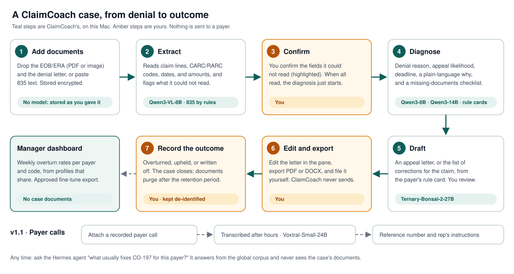

  

<h1 align="center">ClaimCoach</h1>

  <strong>A denial-management specialist for every entry-level medical biller. 
  Built to process claim evidence on the practice's Mac.</strong>

  Built for Y Combinator's Winter 2027 Request for Startups, <em>"The $15-an-Hour Expert"</em>.

---

## The problem

Claim denials are routine, and working them takes specialist knowledge: what each code means,
each payer's rules, appeal deadlines, and which documents win an appeal. Small practices and
billing services give this work to entry-level staff who don't have that knowledge yet. They write
off revenue that could have been recovered, or file weak appeals.

Cloud AI is a hard sell here. Every denial is full of protected health information (PHI), and
every cloud vendor brings a business associate agreement and a data-flow review.

## What ClaimCoach does

The biller drops a denied claim into a pane in Hermes Desktop: the EOB or ERA, the payer's letter,
or pasted 835 text. On the same Mac, ClaimCoach:

- **Reads the denial.** It extracts the claim lines, CARC/RARC and group codes, dates, and amounts,
  and highlights anything it couldn't read for the biller to confirm.
- **Explains it in plain language.** The likely root cause, an appeal likelihood (low, medium, or
  high, with reasons), the appeal deadline, and a checklist of missing documents.
- **Drafts the fix.** An appeal letter from the payer's rule card and a template, which the biller
  edits and exports as PDF or DOCX. Or, when the claim itself was wrong, a list of the corrections
  to make on it in the billing system, also exportable. Every draft is for human review, and
  ClaimCoach never sends or submits anything.
- **Records outcomes.** The biller records whether the appeal was overturned, upheld, or written
  off. The manager sees weekly overturn rates per payer and code from the profiles that opt in,
  and can approve a de-identified export to fine-tune the model later.
- **Answers questions from the shared corpus.** Ask the Hermes agent "what usually fixes CO-197
  for this payer?" It answers from the shared rules and codes. About a case, it sees only a
  redacted summary, never the patient's documents.

## Who it's for

| Who | What they get |
| --- | --- |
| **Entry-level biller or front-desk staff** | Knows what to do with a denial without escalating every case |
| **Billing manager** at a small practice or billing service | A higher overturn rate, consistent appeals, and a view of denial patterns |
| **Practice owner** | Recovered revenue without sending PHI to a cloud vendor |

## Why it runs on the Mac

ClaimCoach is designed to run on the practice's own Mac with local open-weight models (8B to 27B
parameters, Apple MLX). ClaimCoach has no hosted case-processing service. The demonstration's
model routes use loopback endpoints with no configured cloud fallback; this configuration check
is not a compliance certification or an independent zero-egress audit.

- Case-processing models run locally. Model downloads require confirmation.
  If your Hermes chat agent uses a cloud model, it receives only case IDs, codes, payer names, and
  redacted summaries.
- Each biller's cases are encrypted at rest, with the key in the macOS Keychain. Every case access
  is written to an audit log.
- Logs, events, and anything the chat agent sees are redacted first.
- Source documents are purged automatically after a retention period (90 days after a case closes
  by default).

## v1 targets

From the product requirements:

| Goal | Metric | v1 target |
| --- | --- | --- |
| Correct diagnosis | Denial-reason classification accuracy on a labeled set of de-identified cases | ≥ 85% |
| Useful drafts | Appeal letters accepted with only minor edits (manager review rubric) | ≥ 70% |
| Faster work | Median time from denial upload to appeal-ready draft | ≤ 10 min (vs. ~45 min baseline, to be measured) |
| Safe logs | PHI recall of the redactor on a synthetic PHI test set (names, DOB, MRN, member ID, SSN, address, phone) | ≥ 98% |
| Fully local | Outbound network calls carrying case content | 0 |

A release ships only when every target is met against the real local models. Two inputs still have
to be sourced: a labeled, de-identified denial set (the classification gate runs on 20 synthetic
cases until then) and the manager's reviews of real drafts.

## Status

The implemented workflows include intake and extraction, diagnosis, appeal letters and
corrected-claim lists, outcomes, the manager dashboard, agent tools, the desktop pane, and
payer-call transcription (v1.1). The offline application gate passed with 1,876 Python tests,
191 JavaScript tests and 100% application coverage; one Python test was skipped because the
live worker occupied its port, and 14 tests were deselected.

On November 2, 2026, a fictional 835 denial completed an actual Hermes Desktop workflow using
local models: intake, diagnosis, drafting, operator edits and PDF/DOCX export. The Hermes agent
also used the denial-triage skill and all three ClaimCoach tools. The run used an Apple M3 Pro
Mac with 36 GiB RAM, ternary Bonsai 27B text weights and Qwen3 Embedding 8B weights.

This is a working prototype, not a validated production release. The model produced unsupported
statements that required correction, and memory pressure required a drafting retry. OCR and
call transcription were not exercised because their model weights were absent. Real-case
accuracy, billing outcomes and the full release gates remain unvalidated. See the
[recorded findings](docs/video-artifacts/quality-review.md).

Out of scope for v1: EHR, practice-management, or clearinghouse integrations; submitting appeals or
claims to payers; coding new claims; and medical or legal advice.

## Learn more

- **[Watch the English product demo](docs/video-artifacts/film/claimcoach-walkthrough.en.mp4):**
  2:07 walkthrough with captions, actual desktop captures and local Chatterbox narration.
- **[Video artifacts and reproduction](docs/video-artifacts/README.md)** and the
  **[YC application guide](YCOMBINATOR.md)**.
- **[Developer guide](README-DEV.md):** models, install, configuration, the daily start, the REST
  API, the database, storage, and uploads.
- **[Product requirements](PRD.md)** and the **[backlog](SPECS.md)**.
- **[Runbooks](docs/runbooks/README.md)** and **[architecture decisions](docs/adr/README.md)**.
