# ClaimCoach — SPECS

CODEBASE Context: absent (greenfield)

Sources: `PRD.md` (Draft v0.1, 2026-10-30), including §7.9 platform constraints PC-1..PC-8 and §13 engineering standards ES-1..ES-9 (Product Manager decision, 2026-10-30).

## Table of Contents

- [EPIC-1: Engineering Foundation](#epic-1-engineering-foundation)
  - [US-1.1: Plugin Package Scaffold and Manifest](#us-11-plugin-package-scaffold-and-manifest)
  - [US-1.2: Worker Sidecar with Per-Launch Token](#us-12-worker-sidecar-with-per-launch-token)
  - [US-1.3: Thin Typed plugin_api Proxy and Error Envelope](#us-13-thin-typed-plugin_api-proxy-and-error-envelope)
  - [US-1.4: Quality Gate and Test Harnesses](#us-14-quality-gate-and-test-harnesses)
  - [US-1.5: Evidence Template, Runbook Skeletons, and ADR-0001](#us-15-evidence-template-runbook-skeletons-and-adr-0001)
- [EPIC-2: Local Model Management](#epic-2-local-model-management)
  - [US-2.1: Model Role Registry in models.yaml](#us-21-model-role-registry-in-modelsyaml)
  - [US-2.2: Lazy Start, Health Check, and Idle Unload](#us-22-lazy-start-health-check-and-idle-unload)
  - [US-2.3: Memory Guard and Queueing](#us-23-memory-guard-and-queueing)
  - [US-2.4: Missing-Model Detection, Confirmed Download, and Reranker Conversion](#us-24-missing-model-detection-confirmed-download-and-reranker-conversion)
- [EPIC-3: PHI Boundary and Redaction](#epic-3-phi-boundary-and-redaction)
  - [US-3.1: PHI Span Detector with Regex Validators](#us-31-phi-span-detector-with-regex-validators)
  - [US-3.2: Handler-Level Redaction of Agent Tool Results](#us-32-handler-level-redaction-of-agent-tool-results)
  - [US-3.3: PHI Flows Bypass the Agent Transcript](#us-33-phi-flows-bypass-the-agent-transcript)
  - [US-3.4: PHI-Free Logs and Events](#us-34-phi-free-logs-and-events)
  - [US-3.5: Richer Agent Access When the Hermes Model Is Local](#us-35-richer-agent-access-when-the-hermes-model-is-local)
  - [US-3.6: Uploaded Text Treated as Data in Prompts](#us-36-uploaded-text-treated-as-data-in-prompts)
- [EPIC-4: Corpus Scopes and Storage](#epic-4-corpus-scopes-and-storage)
  - [US-4.1: Global and User Scope Stores](#us-41-global-and-user-scope-stores)
  - [US-4.2: User Scope Encrypted at Rest](#us-42-user-scope-encrypted-at-rest)
  - [US-4.3: Global Corpus Import with Provenance](#us-43-global-corpus-import-with-provenance)
  - [US-4.4: Retrieval Limited to Global Plus Current Case](#us-44-retrieval-limited-to-global-plus-current-case)
  - [US-4.5: Retention Auto-Purge of Source Documents](#us-45-retention-auto-purge-of-source-documents)
  - [US-4.6: Audit Log of Case Access](#us-46-audit-log-of-case-access)
- [EPIC-5: Case Intake and Extraction](#epic-5-case-intake-and-extraction)
  - [US-5.1: Create a Case and Add Documents](#us-51-create-a-case-and-add-documents)
  - [US-5.2: Structured Extraction and Field Confirmation](#us-52-structured-extraction-and-field-confirmation)
- [EPIC-6: Diagnosis](#epic-6-diagnosis)
  - [US-6.1: Denial Classification and Appeal Likelihood](#us-61-denial-classification-and-appeal-likelihood)
  - [US-6.2: Plain-Language Explanation and Missing-Documentation Checklist](#us-62-plain-language-explanation-and-missing-documentation-checklist)
  - [US-6.3: Appeal Deadline](#us-63-appeal-deadline)
- [EPIC-7: Appeal Drafting and Export](#epic-7-appeal-drafting-and-export)
  - [US-7.1: Draft the Appeal Letter](#us-71-draft-the-appeal-letter)
  - [US-7.2: Edit and Export the Draft](#us-72-edit-and-export-the-draft)
  - [US-7.3: No Send or Submit Anywhere](#us-73-no-send-or-submit-anywhere)
  - [US-7.4: Corrected Claim Draft](#us-74-corrected-claim-draft)
- [EPIC-8: Outcomes, Manager Dashboard, and Export](#epic-8-outcomes-manager-dashboard-and-export)
  - [US-8.1: Record a Case Outcome](#us-81-record-a-case-outcome)
  - [US-8.2: Opt-In De-identified Aggregation and Weekly Summary](#us-82-opt-in-de-identified-aggregation-and-weekly-summary)
  - [US-8.3: Manager-Approved Fine-Tune Export](#us-83-manager-approved-fine-tune-export)
- [EPIC-9: Hermes Agent Integration](#epic-9-hermes-agent-integration)
  - [US-9.1: Code and Payer-Rule Tools](#us-91-code-and-payer-rule-tools)
  - [US-9.2: Redacted Case Summary Tool](#us-92-redacted-case-summary-tool)
  - [US-9.3: Denial-Triage Skill](#us-93-denial-triage-skill)
  - [US-9.4: The /denial Slash Command](#us-94-the-denial-slash-command)
- [EPIC-10: Desktop UI](#epic-10-desktop-ui)
  - [US-10.1: Case Pane and Manager Dashboard Route](#us-101-case-pane-and-manager-dashboard-route)
  - [US-10.2: Local-Only Statusbar Indicator](#us-102-local-only-statusbar-indicator)
  - [US-10.3: Settings Page for Models, Corpus, and Retention](#us-103-settings-page-for-models-corpus-and-retention)
- [EPIC-11: Payer-Call Transcription (v1.1)](#epic-11-payer-call-transcription-v11)
  - [US-11.1: Transcribe Recorded Payer Calls After Hours](#us-111-transcribe-recorded-payer-calls-after-hours)
- [EPIC-12: Evals and Release Gates](#epic-12-evals-and-release-gates)
  - [US-12.1: Redaction Recall Release Gate](#us-121-redaction-recall-release-gate)
  - [US-12.2: Classification and Draft-Quality Gates](#us-122-classification-and-draft-quality-gates)
  - [US-12.3: Upload-to-Draft Latency Measurement](#us-123-upload-to-draft-latency-measurement)
  - [US-12.4: Zero-Egress Check for Case Content](#us-124-zero-egress-check-for-case-content)

## Work Item Status

| ID | Title | Status | Parent |
|---|---|---|---|
| EPIC-1 | Engineering Foundation | DONE | — |
| US-1.1 | Plugin Package Scaffold and Manifest | DONE | EPIC-1 |
| US-1.1#1 | Create plugin/ tree per PRD §7 (plugin.yaml, __init__.py, skills/denial-triage/, dashboar… | DONE | US-1.1 |
| US-1.1#2 | Define typed ClaimCoachSettings (Pydantic v2) and mirror it in plugin.yaml config_schema | DONE | US-1.1 |
| US-1.1#3 | Add tests test_us_1_1_manifest_declares_v2_fields, test_us_1_1_backend_manifest_points_at… | DONE | US-1.1 |
| US-1.1#4 | Write docs/runbooks/install-enable.md (Preconditions, Steps, Verification, Rollback) | DONE | US-1.1 |
| US-1.1#5 | Record evidence/US-1.1/test-report.md | DONE | US-1.1 |
| US-1.2 | Worker Sidecar with Per-Launch Token | DONE | EPIC-1 |
| US-1.2#1 | Implement claimcoach/worker/app.py (FastAPI) and worker/launcher.py with typed WorkerConf… | DONE | US-1.2 |
| US-1.2#2 | Generate the token with secrets.token_urlsafe and write the file with 0600 permissions | DONE | US-1.2 |
| US-1.2#3 | Add tests test_us_1_2_worker_binds_loopback, test_us_1_2_worker_writes_per_launch_token,… | DONE | US-1.2 |
| US-1.2#4 | Write docs/runbooks/worker-start-stop-health.md | DONE | US-1.2 |
| US-1.2#5 | Record evidence/US-1.2/test-report.md | DONE | US-1.2 |
| US-1.3 | Thin Typed plugin_api Proxy and Error Envelope | DONE | EPIC-1 |
| US-1.3#1 | Implement dashboard/plugin_api.py router = APIRouter() with typed ApiError, ErrorEnvelope… | DONE | US-1.3 |
| US-1.3#2 | Add a single httpx-based WorkerClient with typed methods; no bare except (catch httpx.HTT… | DONE | US-1.3 |
| US-1.3#3 | Add tests test_us_1_3_health_proxies_to_worker, test_us_1_3_worker_unavailable_returns_en… | DONE | US-1.3 |
| US-1.3#4 | Record evidence/US-1.3/test-report.md | DONE | US-1.3 |
| US-1.4 | Quality Gate and Test Harnesses | DONE | EPIC-1 |
| US-1.4#1 | Add Makefile check target, pyproject.toml (ruff, mypy strict, pytest, coverage ≥ 85% fail… | DONE | US-1.4 |
| US-1.4#2 | Write types/hermes-plugin-sdk.d.ts covering the SDK surfaces ClaimCoach uses (PC-3), with… | DONE | US-1.4 |
| US-1.4#3 | Implement tests/fakes/fake_model_server.py (OpenAI-compatible /v1/models and /v1/chat/com… | DONE | US-1.4 |
| US-1.4#4 | Add a pytest socket guard fixture that fails on non-loopback connections | DONE | US-1.4 |
| US-1.4#5 | Add tests test_us_1_4_make_check_passes, test_us_1_4_type_error_fails_gate, test_us_1_4_p… | DONE | US-1.4 |
| US-1.4#6 | Record evidence/US-1.4/test-report.md | DONE | US-1.4 |
| US-1.5 | Evidence Template, Runbook Skeletons, and ADR-0001 | DONE | EPIC-1 |
| US-1.5#1 | Create evidence/TEMPLATE/test-report.md and a short evidence/README.md explaining UNVERIF… | DONE | US-1.5 |
| US-1.5#2 | Create the runbook skeletons listed in the scenario, including docs/runbooks/phi-purge.md… | DONE | US-1.5 |
| US-1.5#3 | Write docs/adr/0001-worker-sidecar.md | DONE | US-1.5 |
| US-1.5#4 | Add tests test_us_1_5_evidence_template_contract, test_us_1_5_runbooks_have_sections, tes… | DONE | US-1.5 |
| US-1.5#5 | Record evidence/US-1.5/test-report.md | DONE | US-1.5 |
| EPIC-2 | Local Model Management | DONE | — |
| US-2.1 | Model Role Registry in models.yaml | DONE | EPIC-2 |
| US-2.1#1 | Implement claimcoach/models/registry.py with ModelRole (enum), ModelSpec, and ModelRegist… | DONE | US-2.1 |
| US-2.1#2 | Ship a default models.yaml written to the plugin data dir on first run | DONE | US-2.1 |
| US-2.1#3 | Add tests test_us_2_1_every_role_registered, test_us_2_1_paths_resolve_under_models_home,… | DONE | US-2.1 |
| US-2.1#4 | Record evidence/US-2.1/test-report.md | DONE | US-2.1 |
| US-2.2 | Lazy Start, Health Check, and Idle Unload | DONE | EPIC-2 |
| US-2.2#1 | Implement claimcoach/models/manager.py with typed ModelStatus and an async ModelManager (… | DONE | US-2.2 |
| US-2.2#2 | Add tests test_us_2_2_server_starts_on_first_use, test_us_2_2_unhealthy_server_not_used,… | DONE | US-2.2 |
| US-2.2#3 | Update docs/runbooks/worker-start-stop-health.md with model-server sections | DONE | US-2.2 |
| US-2.2#4 | Record evidence/US-2.2/test-report.md | DONE | US-2.2 |
| US-2.3 | Memory Guard and Queueing | DONE | EPIC-2 |
| US-2.3#1 | Implement claimcoach/models/memory_guard.py with typed ResidencyPolicy and a size-tier ta… | DONE | US-2.3 |
| US-2.3#2 | Add tests test_us_2_3_two_large_models_never_resident, test_us_2_3_voxtral_loads_alone, t… | DONE | US-2.3 |
| US-2.3#3 | Update docs/runbooks/troubleshooting.md (memory pressure) | DONE | US-2.3 |
| US-2.3#4 | Record evidence/US-2.3/test-report.md | DONE | US-2.3 |
| US-2.4 | Missing-Model Detection, Confirmed Download, and Reranker Conversion | DONE | EPIC-2 |
| US-2.4#1 | Implement claimcoach/models/acquire.py with typed DownloadRequest, ConversionRequest, Acq… | DONE | US-2.4 |
| US-2.4#2 | Add REST routes for status, download, and convert behind explicit confirmation flags | DONE | US-2.4 |
| US-2.4#3 | Add tests test_us_2_4_missing_models_reported, test_us_2_4_download_requires_confirmation… | DONE | US-2.4 |
| US-2.4#4 | Write docs/runbooks/model-download-convert.md | DONE | US-2.4 |
| US-2.4#5 | Record evidence/US-2.4/test-report.md | DONE | US-2.4 |
| EPIC-3 | PHI Boundary and Redaction | — | — |
| US-3.1 | PHI Span Detector with Regex Validators | DONE | EPIC-3 |
| US-3.1#1 | Implement claimcoach/redact/detector.py (Qwen3-8B JSON span prompt) and claimcoach/redact… | DONE | US-3.1 |
| US-3.1#2 | Generate a synthetic PHI fixture set under tests/fixtures/phi/ (no real PHI) | DONE | US-3.1 |
| US-3.1#3 | Add tests test_us_3_1_spans_carry_category (marked models), test_us_3_1_redacted_text_rep… | DONE | US-3.1 |
| US-3.1#4 | Record evidence/US-3.1/test-report.md | DONE | US-3.1 |
| US-3.2 | Handler-Level Redaction of Agent Tool Results | DONE | EPIC-3 |
| US-3.2#1 | Implement claimcoach/agent/guard.py with a typed redact_tool_result() decorator applied t… | DONE | US-3.2 |
| US-3.2#2 | Add tests test_us_3_2_tool_results_phi_free_without_hook, test_us_3_2_hook_re_redacts, te… | DONE | US-3.2 |
| US-3.2#3 | Record evidence/US-3.2/test-report.md | DONE | US-3.2 |
| US-3.3 | PHI Flows Bypass the Agent Transcript | DONE | EPIC-3 |
| US-3.3#1 | Implement the case API client in plugin.js as a typed (JSDoc) module that only wraps ctx.… | DONE | US-3.3 |
| US-3.3#2 | Add tests test_us_3_3_pane_uses_only_plugin_rest (node --test), test_us_3_3_case_processi… | DONE | US-3.3 |
| US-3.3#3 | Record evidence/US-3.3/test-report.md | DONE | US-3.3 |
| US-3.4 | PHI-Free Logs and Events | DONE | EPIC-3 |
| US-3.4#1 | Implement claimcoach/logging.py (JSON formatter + redaction filter) and typed event paylo… | DONE | US-3.4 |
| US-3.4#2 | Add tests test_us_3_4_logs_json_without_document_text, test_us_3_4_events_carry_no_phi | DONE | US-3.4 |
| US-3.4#3 | Record evidence/US-3.4/test-report.md | DONE | US-3.4 |
| US-3.5 | Richer Agent Access When the Hermes Model Is Local | NEEDS CLARIFICATION | EPIC-3 |
| US-3.5#1 | Define the setting in ClaimCoachSettings and config_schema once the scope is decided | TODO | US-3.5 |
| US-3.6 | Uploaded Text Treated as Data in Prompts | DONE | EPIC-3 |
| US-3.6#1 | Implement claimcoach/prompts/builder.py with a typed PromptParts model and a single data-… | DONE | US-3.6 |
| US-3.6#2 | Add test test_us_3_6_prompts_place_text_in_data_section | DONE | US-3.6 |
| US-3.6#3 | Record evidence/US-3.6/test-report.md | DONE | US-3.6 |
| EPIC-4 | Corpus Scopes and Storage | — | — |
| US-4.1 | Global and User Scope Stores | READY | EPIC-4 |
| US-4.1#1 | Implement claimcoach/corpus/paths.py and claimcoach/corpus/store.py with typed CorpusScop… | TODO | US-4.1 |
| US-4.1#2 | Record the embedding model ID per index so a model change forces reindex | TODO | US-4.1 |
| US-4.1#3 | Add tests test_us_4_1_global_scope_under_root, test_us_4_1_user_scope_follows_profile, te… | TODO | US-4.1 |
| US-4.1#4 | Write docs/runbooks/corpus-import-reindex-backup-restore.md (reindex and backup sections) | TODO | US-4.1 |
| US-4.1#5 | Record evidence/US-4.1/test-report.md | TODO | US-4.1 |
| US-4.2 | User Scope Encrypted at Rest | READY | EPIC-4 |
| US-4.2#1 | Implement claimcoach/corpus/crypto.py with a typed KeyProvider protocol (Keychain impleme… | TODO | US-4.2 |
| US-4.2#2 | Add tests test_us_4_2_user_store_not_plaintext, test_us_4_2_key_in_keychain | TODO | US-4.2 |
| US-4.2#3 | Record evidence/US-4.2/test-report.md | TODO | US-4.2 |
| US-4.3 | Global Corpus Import with Provenance | NEEDS CLARIFICATION | EPIC-4 |
| US-4.3#1 | Implement the corpus import CLI subcommand and settings-page import with typed RuleCard,… | TODO | US-4.3 |
| US-4.3#2 | Update docs/runbooks/corpus-import-reindex-backup-restore.md (import section) | TODO | US-4.3 |
| US-4.4 | Retrieval Limited to Global Plus Current Case | READY | EPIC-4 |
| US-4.4#1 | Implement claimcoach/corpus/retrieve.py with a typed RetrievalQuery that requires a case_… | TODO | US-4.4 |
| US-4.4#2 | Add tests test_us_4_4_other_case_chunks_never_retrieved, test_us_4_4_global_chunks_availa… | TODO | US-4.4 |
| US-4.4#3 | Record evidence/US-4.4/test-report.md | TODO | US-4.4 |
| US-4.5 | Retention Auto-Purge of Source Documents | READY | EPIC-4 |
| US-4.5#1 | Implement claimcoach/corpus/retention.py with typed RetentionPolicy and a scheduled purge… | TODO | US-4.5 |
| US-4.5#2 | Add tests test_us_4_5_expired_documents_purged, test_us_4_5_outcomes_survive_deidentified… | TODO | US-4.5 |
| US-4.5#3 | Fill docs/runbooks/phi-purge.md (manual purge and verification) | TODO | US-4.5 |
| US-4.5#4 | Record evidence/US-4.5/test-report.md | TODO | US-4.5 |
| US-4.6 | Audit Log of Case Access | NEEDS CLARIFICATION | EPIC-4 |
| US-4.6#1 | Implement a typed AuditEntry model and append-only audit store once fields and retention… | TODO | US-4.6 |
| EPIC-5 | Case Intake and Extraction | — | — |
| US-5.1 | Create a Case and Add Documents | READY | EPIC-5 |
| US-5.1#1 | Implement case creation and attachment routes with typed CaseCreate, Case, SourceDocument… | TODO | US-5.1 |
| US-5.1#2 | Implement the pane drop zone and paste box in plugin.js (JSDoc-typed) | TODO | US-5.1 |
| US-5.1#3 | Add tests test_us_5_1_pdf_or_image_attached, test_us_5_1_pasted_835_attached | TODO | US-5.1 |
| US-5.1#4 | Record evidence/US-5.1/test-report.md | TODO | US-5.1 |
| US-5.2 | Structured Extraction and Field Confirmation | READY | EPIC-5 |
| US-5.2#1 | Implement claimcoach/pipeline/extract.py (PyMuPDF rasterize → Qwen3-VL-8B per page; 835 p… | TODO | US-5.2 |
| US-5.2#2 | Add tests test_us_5_2_extraction_fills_case (marked models), test_us_5_2_unreadable_field… | TODO | US-5.2 |
| US-5.2#3 | Record evidence/US-5.2/test-report.md | TODO | US-5.2 |
| EPIC-6 | Diagnosis | — | — |
| US-6.1 | Denial Classification and Appeal Likelihood | READY | EPIC-6 |
| US-6.1#1 | Implement claimcoach/pipeline/diagnose.py with typed DenialReason, AppealLikelihood (enum… | TODO | US-6.1 |
| US-6.1#2 | Add tests test_us_6_1_classification_typed_result, test_us_6_1_likelihood_includes_reasons | TODO | US-6.1 |
| US-6.1#3 | Record evidence/US-6.1/test-report.md | TODO | US-6.1 |
| US-6.2 | Plain-Language Explanation and Missing-Documentation Checklist | READY | EPIC-6 |
| US-6.2#1 | Implement claimcoach/pipeline/explain.py with typed Explanation, ChecklistItem | TODO | US-6.2 |
| US-6.2#2 | Add tests test_us_6_2_explanation_and_root_cause_shown, test_us_6_2_checklist_lists_missi… | TODO | US-6.2 |
| US-6.2#3 | Record evidence/US-6.2/test-report.md | TODO | US-6.2 |
| US-6.3 | Appeal Deadline | READY | EPIC-6 |
| US-6.3#1 | Implement a pure, typed compute_deadline() in claimcoach/pipeline/deadline.py with docstr… | TODO | US-6.3 |
| US-6.3#2 | Add test test_us_6_3_deadline_from_rule_card | TODO | US-6.3 |
| US-6.3#3 | Record evidence/US-6.3/test-report.md | TODO | US-6.3 |
| EPIC-7 | Appeal Drafting and Export | — | — |
| US-7.1 | Draft the Appeal Letter | READY | EPIC-7 |
| US-7.1#1 | Implement claimcoach/letters/draft.py with typed DraftRequest, AppealDraft | TODO | US-7.1 |
| US-7.1#2 | Add tests test_us_7_1_draft_from_rule_card_and_template, test_us_7_1_draft_carries_review… | TODO | US-7.1 |
| US-7.1#3 | Record evidence/US-7.1/test-report.md | TODO | US-7.1 |
| US-7.2 | Edit and Export the Draft | READY | EPIC-7 |
| US-7.2#1 | Implement claimcoach/letters/export.py with typed ExportRequest (format enum PDF, DOCX) a… | TODO | US-7.2 |
| US-7.2#2 | Add tests test_us_7_2_edits_saved, test_us_7_2_export_pdf, test_us_7_2_export_docx | TODO | US-7.2 |
| US-7.2#3 | Record evidence/US-7.2/test-report.md | TODO | US-7.2 |
| US-7.3 | No Send or Submit Anywhere | READY | EPIC-7 |
| US-7.3#1 | Add a route-table test and a contribution-label test; document the rule in the module doc… | TODO | US-7.3 |
| US-7.3#2 | Add tests test_us_7_3_no_send_contribution, test_us_7_3_no_transmitting_route | TODO | US-7.3 |
| US-7.3#3 | Record evidence/US-7.3/test-report.md | TODO | US-7.3 |
| US-7.4 | Corrected Claim Draft | NEEDS CLARIFICATION | EPIC-7 |
| US-7.4#1 | Define the corrected-claim output once its format is decided | TODO | US-7.4 |
| EPIC-8 | Outcomes, Manager Dashboard, and Export | — | — |
| US-8.1 | Record a Case Outcome | READY | EPIC-8 |
| US-8.1#1 | Implement typed CaseOutcome (enum) and the outcome route; store outcomes in a de-identifi… | TODO | US-8.1 |
| US-8.1#2 | Add test test_us_8_1_outcome_recorded | TODO | US-8.1 |
| US-8.1#3 | Record evidence/US-8.1/test-report.md | TODO | US-8.1 |
| US-8.2 | Opt-In De-identified Aggregation and Weekly Summary | NEEDS CLARIFICATION | EPIC-8 |
| US-8.2#1 | Implement the aggregation job and typed WeeklySummary once measures and opt-in UX are dec… | TODO | US-8.2 |
| US-8.3 | Manager-Approved Fine-Tune Export | NEEDS CLARIFICATION | EPIC-8 |
| US-8.3#1 | Implement the export with typed ExportApproval and FineTuneRecord once the format is deci… | TODO | US-8.3 |
| EPIC-9 | Hermes Agent Integration | — | — |
| US-9.1 | Code and Payer-Rule Tools | READY | EPIC-9 |
| US-9.1#1 | Register both tools with ctx.register_tool; generate schemas from ExplainCodeParams/Expla… | TODO | US-9.1 |
| US-9.1#2 | Add tests test_us_9_1_explain_code_from_global, test_us_9_1_payer_rules_returns_card | TODO | US-9.1 |
| US-9.1#3 | Record evidence/US-9.1/test-report.md | TODO | US-9.1 |
| US-9.2 | Redacted Case Summary Tool | READY | EPIC-9 |
| US-9.2#1 | Register the tool with typed CaseSummaryParams and CaseSummaryResult | TODO | US-9.2 |
| US-9.2#2 | Add tests test_us_9_2_summary_accepts_only_case_id, test_us_9_2_summary_redacted | TODO | US-9.2 |
| US-9.2#3 | Record evidence/US-9.2/test-report.md | TODO | US-9.2 |
| US-9.3 | Denial-Triage Skill | READY | EPIC-9 |
| US-9.3#1 | Write skills/denial-triage/SKILL.md and register it with ctx.register_skill | TODO | US-9.3 |
| US-9.3#2 | Add tests test_us_9_3_skill_registered, test_us_9_3_skill_contains_no_phi | TODO | US-9.3 |
| US-9.3#3 | Record evidence/US-9.3/test-report.md | TODO | US-9.3 |
| US-9.4 | The /denial Slash Command | NEEDS CLARIFICATION | EPIC-9 |
| US-9.4#1 | Register the command with ctx.register_command once its behavior is decided | TODO | US-9.4 |
| EPIC-10 | Desktop UI | — | — |
| US-10.1 | Case Pane and Manager Dashboard Route | READY | EPIC-10 |
| US-10.1#1 | Implement pane and route components with jsx()/jsxs() (no JSX) and JSDoc types for every… | TODO | US-10.1 |
| US-10.1#2 | Add tests test_us_10_1_case_pane_registered, test_us_10_1_dashboard_route_registered, tes… | TODO | US-10.1 |
| US-10.1#3 | Record evidence/US-10.1/test-report.md | TODO | US-10.1 |
| US-10.2 | Local-Only Statusbar Indicator | READY | EPIC-10 |
| US-10.2#1 | Implement the statusbar contribution (STATUSBAR_AREAS.right) with a JSDoc-typed state mod… | TODO | US-10.2 |
| US-10.2#2 | Add test test_us_10_2_indicator_local_only_default | TODO | US-10.2 |
| US-10.2#3 | Record evidence/US-10.2/test-report.md | TODO | US-10.2 |
| US-10.3 | Settings Page for Models, Corpus, and Retention | READY | EPIC-10 |
| US-10.3#1 | Implement the settings page with model status (from US-2.4), corpus status, and retention… | TODO | US-10.3 |
| US-10.3#2 | Add tests test_us_10_3_settings_registers_when_supported, test_us_10_3_settings_degrade_w… | TODO | US-10.3 |
| US-10.3#3 | Record evidence/US-10.3/test-report.md | TODO | US-10.3 |
| EPIC-11 | Payer-Call Transcription (v1.1) | — | — |
| US-11.1 | Transcribe Recorded Payer Calls After Hours | NEEDS CLARIFICATION | EPIC-11 |
| US-11.1#1 | Implement the transcription job with typed TranscriptionJob once the window and outputs a… | TODO | US-11.1 |
| EPIC-12 | Evals and Release Gates | — | — |
| US-12.1 | Redaction Recall Release Gate | READY | EPIC-12 |
| US-12.1#1 | Implement evals/redaction_recall.py with typed EvalResult output and per-category recall | TODO | US-12.1 |
| US-12.1#2 | Add tests test_us_12_1_gate_passes_at_target, test_us_12_1_gate_blocks_below_target | TODO | US-12.1 |
| US-12.1#3 | Record evidence/US-12.1/test-report.md | TODO | US-12.1 |
| US-12.2 | Classification and Draft-Quality Gates | NEEDS CLARIFICATION | EPIC-12 |
| US-12.2#1 | Implement the classification and draft-acceptance evals once the data source and rubric a… | TODO | US-12.2 |
| US-12.3 | Upload-to-Draft Latency Measurement | READY | EPIC-12 |
| US-12.3#1 | Implement evals/latency.py (marked models) writing typed LatencyReport JSON to evidence | TODO | US-12.3 |
| US-12.3#2 | Add test test_us_12_3_latency_reports_median | TODO | US-12.3 |
| US-12.3#3 | Record evidence/US-12.3/test-report.md | TODO | US-12.3 |
| US-12.4 | Zero-Egress Check for Case Content | READY | EPIC-12 |
| US-12.4#1 | Implement evals/egress_check.py using a socket audit hook in the worker and lsof sampling… | TODO | US-12.4 |
| US-12.4#2 | Add test test_us_12_4_full_flow_no_non_loopback_connection | TODO | US-12.4 |
| US-12.4#3 | Record evidence/US-12.4/test-report.md | TODO | US-12.4 |

## Dependency Diagram

Cross-epic view: one subgraph per epic; one dotted edge per declared story dependency (dependency → dependent).

```mermaid
flowchart TD
  subgraph EPIC_1["EPIC-1: Engineering Foundation"]
    US-1_1["US-1.1: Plugin Package Scaffold and Manifest"]
    US-1_2["US-1.2: Worker Sidecar with Per-Launch Token"]
    US-1_3["US-1.3: Thin Typed plugin_api Proxy and Error Envelope"]
    US-1_4["US-1.4: Quality Gate and Test Harnesses"]
    US-1_5["US-1.5: Evidence Template, Runbook Skeletons, and ADR-0…"]
  end
  subgraph EPIC_2["EPIC-2: Local Model Management"]
    US-2_1["US-2.1: Model Role Registry in models.yaml"]
    US-2_2["US-2.2: Lazy Start, Health Check, and Idle Unload"]
    US-2_3["US-2.3: Memory Guard and Queueing"]
    US-2_4["US-2.4: Missing-Model Detection, Confirmed Download, an…"]
  end
  subgraph EPIC_3["EPIC-3: PHI Boundary and Redaction"]
    US-3_1["US-3.1: PHI Span Detector with Regex Validators"]
    US-3_2["US-3.2: Handler-Level Redaction of Agent Tool Results"]
    US-3_3["US-3.3: PHI Flows Bypass the Agent Transcript"]
    US-3_4["US-3.4: PHI-Free Logs and Events"]
    US-3_5["US-3.5: Richer Agent Access When the Hermes Model Is Lo…"]
    US-3_6["US-3.6: Uploaded Text Treated as Data in Prompts"]
  end
  subgraph EPIC_4["EPIC-4: Corpus Scopes and Storage"]
    US-4_1["US-4.1: Global and User Scope Stores"]
    US-4_2["US-4.2: User Scope Encrypted at Rest"]
    US-4_3["US-4.3: Global Corpus Import with Provenance"]
    US-4_4["US-4.4: Retrieval Limited to Global Plus Current Case"]
    US-4_5["US-4.5: Retention Auto-Purge of Source Documents"]
    US-4_6["US-4.6: Audit Log of Case Access"]
  end
  subgraph EPIC_5["EPIC-5: Case Intake and Extraction"]
    US-5_1["US-5.1: Create a Case and Add Documents"]
    US-5_2["US-5.2: Structured Extraction and Field Confirmation"]
  end
  subgraph EPIC_6["EPIC-6: Diagnosis"]
    US-6_1["US-6.1: Denial Classification and Appeal Likelihood"]
    US-6_2["US-6.2: Plain-Language Explanation and Missing-Document…"]
    US-6_3["US-6.3: Appeal Deadline"]
  end
  subgraph EPIC_7["EPIC-7: Appeal Drafting and Export"]
    US-7_1["US-7.1: Draft the Appeal Letter"]
    US-7_2["US-7.2: Edit and Export the Draft"]
    US-7_3["US-7.3: No Send or Submit Anywhere"]
    US-7_4["US-7.4: Corrected Claim Draft"]
  end
  subgraph EPIC_8["EPIC-8: Outcomes, Manager Dashboard, and Export"]
    US-8_1["US-8.1: Record a Case Outcome"]
    US-8_2["US-8.2: Opt-In De-identified Aggregation and Weekly Sum…"]
    US-8_3["US-8.3: Manager-Approved Fine-Tune Export"]
  end
  subgraph EPIC_9["EPIC-9: Hermes Agent Integration"]
    US-9_1["US-9.1: Code and Payer-Rule Tools"]
    US-9_2["US-9.2: Redacted Case Summary Tool"]
    US-9_3["US-9.3: Denial-Triage Skill"]
    US-9_4["US-9.4: The /denial Slash Command"]
  end
  subgraph EPIC_10["EPIC-10: Desktop UI"]
    US-10_1["US-10.1: Case Pane and Manager Dashboard Route"]
    US-10_2["US-10.2: Local-Only Statusbar Indicator"]
    US-10_3["US-10.3: Settings Page for Models, Corpus, and Retention"]
  end
  subgraph EPIC_11["EPIC-11: Payer-Call Transcription (v1.1)"]
    US-11_1["US-11.1: Transcribe Recorded Payer Calls After Hours"]
  end
  subgraph EPIC_12["EPIC-12: Evals and Release Gates"]
    US-12_1["US-12.1: Redaction Recall Release Gate"]
    US-12_2["US-12.2: Classification and Draft-Quality Gates"]
    US-12_3["US-12.3: Upload-to-Draft Latency Measurement"]
    US-12_4["US-12.4: Zero-Egress Check for Case Content"]
  end
  US-1_1 -.-> US-1_2
  US-1_2 -.-> US-1_3
  US-1_1 -.-> US-1_4
  US-1_1 -.-> US-1_5
  US-1_2 -.-> US-2_1
  US-2_1 -.-> US-2_2
  US-2_2 -.-> US-2_3
  US-2_1 -.-> US-2_4
  US-2_2 -.-> US-3_1
  US-3_1 -.-> US-3_2
  US-1_3 -.-> US-3_3
  US-1_4 -.-> US-3_3
  US-3_1 -.-> US-3_4
  US-3_2 -.-> US-3_5
  US-1_2 -.-> US-3_6
  US-1_2 -.-> US-4_1
  US-2_2 -.-> US-4_1
  US-4_1 -.-> US-4_2
  US-4_1 -.-> US-4_3
  US-4_1 -.-> US-4_4
  US-4_1 -.-> US-4_5
  US-8_1 -.-> US-4_5
  US-4_1 -.-> US-4_6
  US-3_3 -.-> US-5_1
  US-4_2 -.-> US-5_1
  US-5_1 -.-> US-5_2
  US-2_2 -.-> US-5_2
  US-3_6 -.-> US-5_2
  US-5_2 -.-> US-6_1
  US-4_4 -.-> US-6_1
  US-6_1 -.-> US-6_2
  US-6_1 -.-> US-6_3
  US-4_1 -.-> US-6_3
  US-6_2 -.-> US-7_1
  US-2_3 -.-> US-7_1
  US-7_1 -.-> US-7_2
  US-7_2 -.-> US-7_3
  US-6_1 -.-> US-7_4
  US-5_1 -.-> US-8_1
  US-8_1 -.-> US-8_2
  US-8_1 -.-> US-8_3
  US-3_1 -.-> US-8_3
  US-3_2 -.-> US-9_1
  US-4_1 -.-> US-9_1
  US-3_2 -.-> US-9_2
  US-6_1 -.-> US-9_2
  US-1_1 -.-> US-9_3
  US-9_2 -.-> US-9_4
  US-1_4 -.-> US-10_1
  US-3_3 -.-> US-10_1
  US-10_1 -.-> US-10_2
  US-10_1 -.-> US-10_3
  US-2_4 -.-> US-10_3
  US-4_5 -.-> US-10_3
  US-2_3 -.-> US-11_1
  US-5_1 -.-> US-11_1
  US-3_1 -.-> US-12_1
  US-6_1 -.-> US-12_2
  US-7_1 -.-> US-12_2
  US-7_1 -.-> US-12_3
  US-7_2 -.-> US-12_4
```

### EPIC-1 detail

```mermaid
flowchart TD
  US-1_1["US-1.1: Plugin Package Scaffold and Manifest"]
  US-1_1_T1["#1 Create plugin/ tree per PRD §7 (plugin.yaml, __…"]
  US-1_1 --> US-1_1_T1
  US-1_1_T2["#2 Define typed ClaimCoachSettings (Pydantic v2) a…"]
  US-1_1 --> US-1_1_T2
  US-1_1_T3["#3 Add tests test_us_1_1_manifest_declares_v2_fiel…"]
  US-1_1 --> US-1_1_T3
  US-1_1_T4["#4 Write docs/runbooks/install-enable.md (Precondi…"]
  US-1_1 --> US-1_1_T4
  US-1_1_T5["#5 Record evidence/US-1.1/test-report.md"]
  US-1_1 --> US-1_1_T5
  US-1_2["US-1.2: Worker Sidecar with Per-Launch Token"]
  US-1_2_T1["#1 Implement claimcoach/worker/app.py (FastAPI) an…"]
  US-1_2 --> US-1_2_T1
  US-1_2_T2["#2 Generate the token with secrets.token_urlsafe a…"]
  US-1_2 --> US-1_2_T2
  US-1_2_T3["#3 Add tests test_us_1_2_worker_binds_loopback, te…"]
  US-1_2 --> US-1_2_T3
  US-1_2_T4["#4 Write docs/runbooks/worker-start-stop-health.md"]
  US-1_2 --> US-1_2_T4
  US-1_2_T5["#5 Record evidence/US-1.2/test-report.md"]
  US-1_2 --> US-1_2_T5
  US-1_3["US-1.3: Thin Typed plugin_api Proxy and Error Envelope"]
  US-1_3_T1["#1 Implement dashboard/plugin_api.py router = APIR…"]
  US-1_3 --> US-1_3_T1
  US-1_3_T2["#2 Add a single httpx-based WorkerClient with type…"]
  US-1_3 --> US-1_3_T2
  US-1_3_T3["#3 Add tests test_us_1_3_health_proxies_to_worker,…"]
  US-1_3 --> US-1_3_T3
  US-1_3_T4["#4 Record evidence/US-1.3/test-report.md"]
  US-1_3 --> US-1_3_T4
  US-1_4["US-1.4: Quality Gate and Test Harnesses"]
  US-1_4_T1["#1 Add Makefile check target, pyproject.toml (ruff…"]
  US-1_4 --> US-1_4_T1
  US-1_4_T2["#2 Write types/hermes-plugin-sdk.d.ts covering the…"]
  US-1_4 --> US-1_4_T2
  US-1_4_T3["#3 Implement tests/fakes/fake_model_server.py (Ope…"]
  US-1_4 --> US-1_4_T3
  US-1_4_T4["#4 Add a pytest socket guard fixture that fails on…"]
  US-1_4 --> US-1_4_T4
  US-1_4_T5["#5 Add tests test_us_1_4_make_check_passes, test_u…"]
  US-1_4 --> US-1_4_T5
  US-1_4_T6["#6 Record evidence/US-1.4/test-report.md"]
  US-1_4 --> US-1_4_T6
  US-1_5["US-1.5: Evidence Template, Runbook Skeletons, and ADR-0…"]
  US-1_5_T1["#1 Create evidence/TEMPLATE/test-report.md and a s…"]
  US-1_5 --> US-1_5_T1
  US-1_5_T2["#2 Create the runbook skeletons listed in the scen…"]
  US-1_5 --> US-1_5_T2
  US-1_5_T3["#3 Write docs/adr/0001-worker-sidecar.md"]
  US-1_5 --> US-1_5_T3
  US-1_5_T4["#4 Add tests test_us_1_5_evidence_template_contrac…"]
  US-1_5 --> US-1_5_T4
  US-1_5_T5["#5 Record evidence/US-1.5/test-report.md"]
  US-1_5 --> US-1_5_T5
```

### EPIC-2 detail

```mermaid
flowchart TD
  US-2_1["US-2.1: Model Role Registry in models.yaml"]
  US-2_1_T1["#1 Implement claimcoach/models/registry.py with Mo…"]
  US-2_1 --> US-2_1_T1
  US-2_1_T2["#2 Ship a default models.yaml written to the plugi…"]
  US-2_1 --> US-2_1_T2
  US-2_1_T3["#3 Add tests test_us_2_1_every_role_registered, te…"]
  US-2_1 --> US-2_1_T3
  US-2_1_T4["#4 Record evidence/US-2.1/test-report.md"]
  US-2_1 --> US-2_1_T4
  US-2_2["US-2.2: Lazy Start, Health Check, and Idle Unload"]
  US-2_2_T1["#1 Implement claimcoach/models/manager.py with typ…"]
  US-2_2 --> US-2_2_T1
  US-2_2_T2["#2 Add tests test_us_2_2_server_starts_on_first_us…"]
  US-2_2 --> US-2_2_T2
  US-2_2_T3["#3 Update docs/runbooks/worker-start-stop-health.m…"]
  US-2_2 --> US-2_2_T3
  US-2_2_T4["#4 Record evidence/US-2.2/test-report.md"]
  US-2_2 --> US-2_2_T4
  US-2_3["US-2.3: Memory Guard and Queueing"]
  US-2_3_T1["#1 Implement claimcoach/models/memory_guard.py wit…"]
  US-2_3 --> US-2_3_T1
  US-2_3_T2["#2 Add tests test_us_2_3_two_large_models_never_re…"]
  US-2_3 --> US-2_3_T2
  US-2_3_T3["#3 Update docs/runbooks/troubleshooting.md (memory…"]
  US-2_3 --> US-2_3_T3
  US-2_3_T4["#4 Record evidence/US-2.3/test-report.md"]
  US-2_3 --> US-2_3_T4
  US-2_4["US-2.4: Missing-Model Detection, Confirmed Download, an…"]
  US-2_4_T1["#1 Implement claimcoach/models/acquire.py with typ…"]
  US-2_4 --> US-2_4_T1
  US-2_4_T2["#2 Add REST routes for status, download, and conve…"]
  US-2_4 --> US-2_4_T2
  US-2_4_T3["#3 Add tests test_us_2_4_missing_models_reported,…"]
  US-2_4 --> US-2_4_T3
  US-2_4_T4["#4 Write docs/runbooks/model-download-convert.md"]
  US-2_4 --> US-2_4_T4
  US-2_4_T5["#5 Record evidence/US-2.4/test-report.md"]
  US-2_4 --> US-2_4_T5
```

### EPIC-3 detail

```mermaid
flowchart TD
  US-3_1["US-3.1: PHI Span Detector with Regex Validators"]
  US-3_1_T1["#1 Implement claimcoach/redact/detector.py (Qwen3-…"]
  US-3_1 --> US-3_1_T1
  US-3_1_T2["#2 Generate a synthetic PHI fixture set under test…"]
  US-3_1 --> US-3_1_T2
  US-3_1_T3["#3 Add tests test_us_3_1_spans_carry_category (mar…"]
  US-3_1 --> US-3_1_T3
  US-3_1_T4["#4 Record evidence/US-3.1/test-report.md"]
  US-3_1 --> US-3_1_T4
  US-3_2["US-3.2: Handler-Level Redaction of Agent Tool Results"]
  US-3_2_T1["#1 Implement claimcoach/agent/guard.py with a type…"]
  US-3_2 --> US-3_2_T1
  US-3_2_T2["#2 Add tests test_us_3_2_tool_results_phi_free_wit…"]
  US-3_2 --> US-3_2_T2
  US-3_2_T3["#3 Record evidence/US-3.2/test-report.md"]
  US-3_2 --> US-3_2_T3
  US-3_3["US-3.3: PHI Flows Bypass the Agent Transcript"]
  US-3_3_T1["#1 Implement the case API client in plugin.js as a…"]
  US-3_3 --> US-3_3_T1
  US-3_3_T2["#2 Add tests test_us_3_3_pane_uses_only_plugin_res…"]
  US-3_3 --> US-3_3_T2
  US-3_3_T3["#3 Record evidence/US-3.3/test-report.md"]
  US-3_3 --> US-3_3_T3
  US-3_4["US-3.4: PHI-Free Logs and Events"]
  US-3_4_T1["#1 Implement claimcoach/logging.py (JSON formatter…"]
  US-3_4 --> US-3_4_T1
  US-3_4_T2["#2 Add tests test_us_3_4_logs_json_without_documen…"]
  US-3_4 --> US-3_4_T2
  US-3_4_T3["#3 Record evidence/US-3.4/test-report.md"]
  US-3_4 --> US-3_4_T3
  US-3_5["US-3.5: Richer Agent Access When the Hermes Model Is Lo…"]
  US-3_5_T1["#1 Define the setting in ClaimCoachSettings and co…"]
  US-3_5 --> US-3_5_T1
  US-3_6["US-3.6: Uploaded Text Treated as Data in Prompts"]
  US-3_6_T1["#1 Implement claimcoach/prompts/builder.py with a…"]
  US-3_6 --> US-3_6_T1
  US-3_6_T2["#2 Add test test_us_3_6_prompts_place_text_in_data…"]
  US-3_6 --> US-3_6_T2
  US-3_6_T3["#3 Record evidence/US-3.6/test-report.md"]
  US-3_6 --> US-3_6_T3
```

### EPIC-4 detail

```mermaid
flowchart TD
  US-4_1["US-4.1: Global and User Scope Stores"]
  US-4_1_T1["#1 Implement claimcoach/corpus/paths.py and claimc…"]
  US-4_1 --> US-4_1_T1
  US-4_1_T2["#2 Record the embedding model ID per index so a mo…"]
  US-4_1 --> US-4_1_T2
  US-4_1_T3["#3 Add tests test_us_4_1_global_scope_under_root,…"]
  US-4_1 --> US-4_1_T3
  US-4_1_T4["#4 Write docs/runbooks/corpus-import-reindex-backu…"]
  US-4_1 --> US-4_1_T4
  US-4_1_T5["#5 Record evidence/US-4.1/test-report.md"]
  US-4_1 --> US-4_1_T5
  US-4_2["US-4.2: User Scope Encrypted at Rest"]
  US-4_2_T1["#1 Implement claimcoach/corpus/crypto.py with a ty…"]
  US-4_2 --> US-4_2_T1
  US-4_2_T2["#2 Add tests test_us_4_2_user_store_not_plaintext,…"]
  US-4_2 --> US-4_2_T2
  US-4_2_T3["#3 Record evidence/US-4.2/test-report.md"]
  US-4_2 --> US-4_2_T3
  US-4_3["US-4.3: Global Corpus Import with Provenance"]
  US-4_3_T1["#1 Implement the corpus import CLI subcommand and…"]
  US-4_3 --> US-4_3_T1
  US-4_3_T2["#2 Update docs/runbooks/corpus-import-reindex-back…"]
  US-4_3 --> US-4_3_T2
  US-4_4["US-4.4: Retrieval Limited to Global Plus Current Case"]
  US-4_4_T1["#1 Implement claimcoach/corpus/retrieve.py with a…"]
  US-4_4 --> US-4_4_T1
  US-4_4_T2["#2 Add tests test_us_4_4_other_case_chunks_never_r…"]
  US-4_4 --> US-4_4_T2
  US-4_4_T3["#3 Record evidence/US-4.4/test-report.md"]
  US-4_4 --> US-4_4_T3
  US-4_5["US-4.5: Retention Auto-Purge of Source Documents"]
  US-4_5_T1["#1 Implement claimcoach/corpus/retention.py with t…"]
  US-4_5 --> US-4_5_T1
  US-4_5_T2["#2 Add tests test_us_4_5_expired_documents_purged,…"]
  US-4_5 --> US-4_5_T2
  US-4_5_T3["#3 Fill docs/runbooks/phi-purge.md (manual purge a…"]
  US-4_5 --> US-4_5_T3
  US-4_5_T4["#4 Record evidence/US-4.5/test-report.md"]
  US-4_5 --> US-4_5_T4
  US-4_6["US-4.6: Audit Log of Case Access"]
  US-4_6_T1["#1 Implement a typed AuditEntry model and append-o…"]
  US-4_6 --> US-4_6_T1
```

### EPIC-5 detail

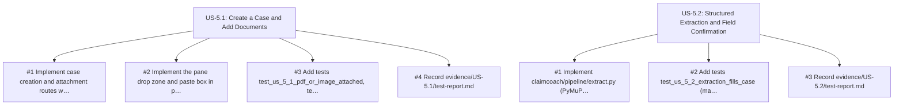

### EPIC-6 detail

```mermaid
flowchart TD
  US-6_1["US-6.1: Denial Classification and Appeal Likelihood"]
  US-6_1_T1["#1 Implement claimcoach/pipeline/diagnose.py with…"]
  US-6_1 --> US-6_1_T1
  US-6_1_T2["#2 Add tests test_us_6_1_classification_typed_resu…"]
  US-6_1 --> US-6_1_T2
  US-6_1_T3["#3 Record evidence/US-6.1/test-report.md"]
  US-6_1 --> US-6_1_T3
  US-6_2["US-6.2: Plain-Language Explanation and Missing-Document…"]
  US-6_2_T1["#1 Implement claimcoach/pipeline/explain.py with t…"]
  US-6_2 --> US-6_2_T1
  US-6_2_T2["#2 Add tests test_us_6_2_explanation_and_root_caus…"]
  US-6_2 --> US-6_2_T2
  US-6_2_T3["#3 Record evidence/US-6.2/test-report.md"]
  US-6_2 --> US-6_2_T3
  US-6_3["US-6.3: Appeal Deadline"]
  US-6_3_T1["#1 Implement a pure, typed compute_deadline() in c…"]
  US-6_3 --> US-6_3_T1
  US-6_3_T2["#2 Add test test_us_6_3_deadline_from_rule_card"]
  US-6_3 --> US-6_3_T2
  US-6_3_T3["#3 Record evidence/US-6.3/test-report.md"]
  US-6_3 --> US-6_3_T3
```

### EPIC-7 detail

```mermaid
flowchart TD
  US-7_1["US-7.1: Draft the Appeal Letter"]
  US-7_1_T1["#1 Implement claimcoach/letters/draft.py with type…"]
  US-7_1 --> US-7_1_T1
  US-7_1_T2["#2 Add tests test_us_7_1_draft_from_rule_card_and_…"]
  US-7_1 --> US-7_1_T2
  US-7_1_T3["#3 Record evidence/US-7.1/test-report.md"]
  US-7_1 --> US-7_1_T3
  US-7_2["US-7.2: Edit and Export the Draft"]
  US-7_2_T1["#1 Implement claimcoach/letters/export.py with typ…"]
  US-7_2 --> US-7_2_T1
  US-7_2_T2["#2 Add tests test_us_7_2_edits_saved, test_us_7_2_…"]
  US-7_2 --> US-7_2_T2
  US-7_2_T3["#3 Record evidence/US-7.2/test-report.md"]
  US-7_2 --> US-7_2_T3
  US-7_3["US-7.3: No Send or Submit Anywhere"]
  US-7_3_T1["#1 Add a route-table test and a contribution-label…"]
  US-7_3 --> US-7_3_T1
  US-7_3_T2["#2 Add tests test_us_7_3_no_send_contribution, tes…"]
  US-7_3 --> US-7_3_T2
  US-7_3_T3["#3 Record evidence/US-7.3/test-report.md"]
  US-7_3 --> US-7_3_T3
  US-7_4["US-7.4: Corrected Claim Draft"]
  US-7_4_T1["#1 Define the corrected-claim output once its form…"]
  US-7_4 --> US-7_4_T1
```

### EPIC-8 detail

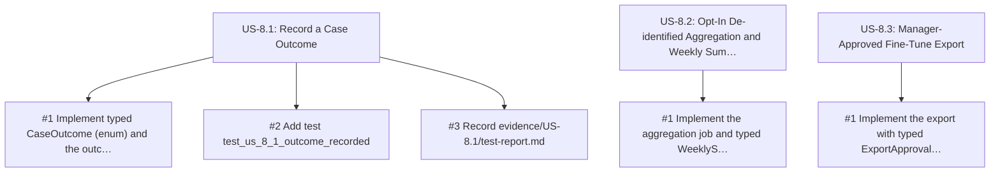

### EPIC-9 detail

```mermaid
flowchart TD
  US-9_1["US-9.1: Code and Payer-Rule Tools"]
  US-9_1_T1["#1 Register both tools with ctx.register_tool; gen…"]
  US-9_1 --> US-9_1_T1
  US-9_1_T2["#2 Add tests test_us_9_1_explain_code_from_global,…"]
  US-9_1 --> US-9_1_T2
  US-9_1_T3["#3 Record evidence/US-9.1/test-report.md"]
  US-9_1 --> US-9_1_T3
  US-9_2["US-9.2: Redacted Case Summary Tool"]
  US-9_2_T1["#1 Register the tool with typed CaseSummaryParams…"]
  US-9_2 --> US-9_2_T1
  US-9_2_T2["#2 Add tests test_us_9_2_summary_accepts_only_case…"]
  US-9_2 --> US-9_2_T2
  US-9_2_T3["#3 Record evidence/US-9.2/test-report.md"]
  US-9_2 --> US-9_2_T3
  US-9_3["US-9.3: Denial-Triage Skill"]
  US-9_3_T1["#1 Write skills/denial-triage/SKILL.md and registe…"]
  US-9_3 --> US-9_3_T1
  US-9_3_T2["#2 Add tests test_us_9_3_skill_registered, test_us…"]
  US-9_3 --> US-9_3_T2
  US-9_3_T3["#3 Record evidence/US-9.3/test-report.md"]
  US-9_3 --> US-9_3_T3
  US-9_4["US-9.4: The /denial Slash Command"]
  US-9_4_T1["#1 Register the command with ctx.register_command…"]
  US-9_4 --> US-9_4_T1
```

### EPIC-10 detail

```mermaid
flowchart TD
  US-10_1["US-10.1: Case Pane and Manager Dashboard Route"]
  US-10_1_T1["#1 Implement pane and route components with jsx()/…"]
  US-10_1 --> US-10_1_T1
  US-10_1_T2["#2 Add tests test_us_10_1_case_pane_registered, te…"]
  US-10_1 --> US-10_1_T2
  US-10_1_T3["#3 Record evidence/US-10.1/test-report.md"]
  US-10_1 --> US-10_1_T3
  US-10_2["US-10.2: Local-Only Statusbar Indicator"]
  US-10_2_T1["#1 Implement the statusbar contribution (STATUSBAR…"]
  US-10_2 --> US-10_2_T1
  US-10_2_T2["#2 Add test test_us_10_2_indicator_local_only_defa…"]
  US-10_2 --> US-10_2_T2
  US-10_2_T3["#3 Record evidence/US-10.2/test-report.md"]
  US-10_2 --> US-10_2_T3
  US-10_3["US-10.3: Settings Page for Models, Corpus, and Retention"]
  US-10_3_T1["#1 Implement the settings page with model status (…"]
  US-10_3 --> US-10_3_T1
  US-10_3_T2["#2 Add tests test_us_10_3_settings_registers_when_…"]
  US-10_3 --> US-10_3_T2
  US-10_3_T3["#3 Record evidence/US-10.3/test-report.md"]
  US-10_3 --> US-10_3_T3
```

### EPIC-11 detail

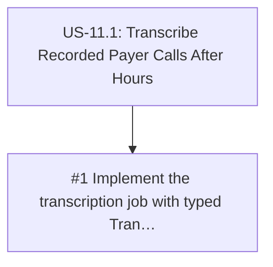

### EPIC-12 detail

```mermaid
flowchart TD
  US-12_1["US-12.1: Redaction Recall Release Gate"]
  US-12_1_T1["#1 Implement evals/redaction_recall.py with typed…"]
  US-12_1 --> US-12_1_T1
  US-12_1_T2["#2 Add tests test_us_12_1_gate_passes_at_target, t…"]
  US-12_1 --> US-12_1_T2
  US-12_1_T3["#3 Record evidence/US-12.1/test-report.md"]
  US-12_1 --> US-12_1_T3
  US-12_2["US-12.2: Classification and Draft-Quality Gates"]
  US-12_2_T1["#1 Implement the classification and draft-acceptan…"]
  US-12_2 --> US-12_2_T1
  US-12_3["US-12.3: Upload-to-Draft Latency Measurement"]
  US-12_3_T1["#1 Implement evals/latency.py (marked models) writ…"]
  US-12_3 --> US-12_3_T1
  US-12_3_T2["#2 Add test test_us_12_3_latency_reports_median"]
  US-12_3 --> US-12_3_T2
  US-12_3_T3["#3 Record evidence/US-12.3/test-report.md"]
  US-12_3 --> US-12_3_T3
  US-12_4["US-12.4: Zero-Egress Check for Case Content"]
  US-12_4_T1["#1 Implement evals/egress_check.py using a socket…"]
  US-12_4 --> US-12_4_T1
  US-12_4_T2["#2 Add test test_us_12_4_full_flow_no_non_loopback…"]
  US-12_4 --> US-12_4_T2
  US-12_4_T3["#3 Record evidence/US-12.4/test-report.md"]
  US-12_4 --> US-12_4_T3
```

## Product Context

ClaimCoach is a standalone Hermes Desktop plugin package (`claimcoach`) that turns an entry-level medical biller into a denial-management specialist. The biller drops a denied claim (EOB/ERA, CARC/RARC codes, payer letter) into a Hermes Desktop pane. ClaimCoach extracts the claim, redacts PHI for logging, explains the denial in plain language, estimates appeal likelihood, lists missing documentation, and drafts an appeal for human review. Everything runs on local models read from `~/Models` on an Apple M3 Pro (36 GiB). **PHI never leaves the Mac.** ClaimCoach shares no code, corpus, processes, or data with PermitPilot or ModelForge.

Source: PRD.md header table, preamble, §1, §2.

Architecture summary (PRD.md §7, §7.9): one unified Hermes plugin package with an agent half (`plugin.yaml`, `__init__.py`, skills), a backend half (`dashboard/plugin_api.py` FastAPI router at `/api/plugins/claimcoach/`), and a desktop half (`desktop/plugin.js`). Heavy work runs in an app-owned **worker** process (venv `~/Models/.venvs/claimcoach`, `127.0.0.1:18200`, per-launch bearer token). `plugin_api.py` and the agent tools are thin, typed proxies to the worker.

Workflow note: PRD.md §12 names this file (`SPECS.md`) as the specs artifact. The §7 folder tree still shows a `specs/` directory, which is a stale reference flagged for Product Manager review (see Open Questions in US-1.1).

## Goals

| ID | Goal | Metric | v1 target | Source |
| --- | --- | --- | --- | --- |
| G-1 | Correct diagnosis | Denial-reason classification accuracy on a labeled set of de-identified cases | ≥ 85% | PRD.md §4 |
| G-2 | Useful drafts | Appeal letters accepted with only minor edits (manager review rubric) | ≥ 70% | PRD.md §4 |
| G-3 | Faster work | Median time from denial upload to appeal-ready draft | ≤ 10 min | PRD.md §4 |
| G-4 | Safe logs | PHI recall of the redactor on a synthetic PHI test set | ≥ 98% | PRD.md §4 |
| G-5 | Fully local | Outbound network calls carrying case content | 0 | PRD.md §4 |

## Non-Goals

Source: PRD.md §5.

- EHR, practice-management, or clearinghouse integrations (upload and paste only).
- Submitting appeals or claims to payers.
- Coding new claims (CPT/ICD assignment) or giving medical or legal advice.
- Multi-site/multi-tenant administration. v1 is one Mac with one or a few Hermes profiles.
- Billing for the app itself.

## Actors

| Actor | Description | Source |
| --- | --- | --- |
| Biller | Entry-level biller or front-desk staff (primary persona); owns cases in their Hermes profile | PRD.md §3, §9 |
| Manager | Billing manager at a small practice or billing service; maintains the global corpus, reviews the dashboard, approves fine-tune exports | PRD.md §3, §6 story 7, §9 |
| Practice owner | Wants recovered revenue without sending PHI to a cloud vendor | PRD.md §3 |
| Hermes agent | The Hermes chat agent; may run on a cloud model, so it only ever sees PHI-free tool results | PRD.md §7.2 |
| Worker | App-owned local process that runs extraction, redaction, retrieval, model calls, and jobs | PRD.md §7.9 |
| Local model servers | MLX/MTPLX servers launched by the worker from `~/Models` | PRD.md §8 |

## Global Business Rules

| ID | Rule | Source |
| --- | --- | --- |
| BR-1 | No case content leaves the Mac. Backend outbound calls are limited to user-confirmed model downloads and corpus imports. | PRD.md §1, §10 |
| BR-2 | All PHI flows go desktop pane → `plugin_api.py` → worker → local models, never through the agent transcript. | PRD.md §7.2 |
| BR-3 | Agent tools accept and return only case IDs, codes, payer names, and redacted summaries. Each handler redacts its own result before returning (primary guard). The `transform_tool_result` hook is defense-in-depth only, because it fails open. | PRD.md §7.2, §7.9 PC-7 |
| BR-4 | Every draft is labeled "draft for human review". There is no send/submit control anywhere, and nothing is auto-sent. | PRD.md §6 story 4, §10 |
| BR-5 | Explanations and drafts retrieve from the `global` scope plus the current case only. One case's PHI is never retrieved into another case's prompt. | PRD.md §9 |
| BR-6 | The `user` scope is encrypted at rest, with the key stored in the macOS Keychain. | PRD.md §9 |
| BR-7 | Source documents auto-purge on a configurable schedule (default 90 days after case close). Outcomes are kept de-identified. | PRD.md §9 |
| BR-8 | The manager view aggregates de-identified outcome stats only from profiles that opted in, and never reads raw case documents. | PRD.md §9 |
| BR-9 | Fine-tune export is explicit, manager-approved, de-identified, and never automatic. | PRD.md §9 |
| BR-10 | Text extracted from uploaded documents is treated as data in every prompt. | PRD.md §10 |
| BR-11 | Model weights are read from `MODELS_HOME` (default `~/Models`) and never copied. ClaimCoach runs its own model servers on ports 18200–18219. | PRD.md §8 |
| BR-12 | Memory guard: never two ≥ 14B models resident at once. Voxtral loads only when nothing else is loaded. | PRD.md §8 |
| BR-13 | Durable state lives under `plugin_data_dir("claimcoach")` (user scope) and `<hermes root>/plugin-data/claimcoach/global/` (global scope), never in the install dir. | PRD.md §7.1, §7.9 PC-6, §9 |
| BR-14 | Logs, events, and agent tool results are redacted. | PRD.md §10 |
| BR-15 | ClaimCoach shares no code, corpus, processes, or data with PermitPilot or ModelForge. | PRD.md preamble |

## Non-Functional Requirements

| ID | Requirement | Source |
| --- | --- | --- |
| NFR-1 | Denial-reason classification accuracy MUST be ≥ 85% on the labeled de-identified eval set. | PRD.md §4 |
| NFR-2 | ≥ 70% of appeal letters MUST be accepted with only minor edits under the manager review rubric. | PRD.md §4 |
| NFR-3 | Median time from denial upload to appeal-ready draft MUST be ≤ 10 min on the M3 Pro. | PRD.md §4 |
| NFR-4 | Redactor PHI recall MUST be ≥ 98% on the synthetic PHI set (names, DOB, MRN, member ID, SSN, address, phone). This is a release gate. | PRD.md §4, §10 |
| NFR-5 | Outbound network calls carrying case content MUST be 0. | PRD.md §4, §10 |
| NFR-6 | The package MUST load on Hermes Agent ≥ 0.22.5 and respect PC-1 through PC-8. | PRD.md §7.9 |
| NFR-7 | Peak resident model memory SHOULD stay within ≈ 22–28 GB, with models loaded in sequence. | PRD.md §8 |
| NFR-8 | Typing: Python 3.12, `mypy --strict` clean, Pydantic v2 models for every REST body, tool parameter/result, event payload, and config file. JS uses `// @ts-check` and passes `tsc --noEmit --checkJs` against `types/hermes-plugin-sdk.d.ts`. | PRD.md §13 ES-1 |
| NFR-9 | Style: `ruff check`, `ruff format --check`, and `biome check` clean. | PRD.md §13 ES-2 |
| NFR-10 | Comments: Google-style docstrings on public modules, classes, and functions. Each module docstring lists the story and rule IDs it implements. | PRD.md §13 ES-3 |
| NFR-11 | Tests: every Gherkin scenario maps to at least one test named `test_us_<epic>_<n>_<slug>`. Offline tests use a fake OpenAI-compatible server, and real-model tests are marked `@pytest.mark.models`. App package line coverage MUST be ≥ 85%. | PRD.md §13 ES-4 |
| NFR-12 | Evidence: each delivered story writes `evidence/US-x.y/test-report.md` (OhMyOrch format) plus JUnit XML, and eval JSON for model-quality stories. An unexercised criterion is `UNVERIFIED`, never `PASS`. | PRD.md §13 ES-5 |
| NFR-13 | Runbooks in `docs/runbooks/`, each with Preconditions, Steps, Verification, and Rollback. | PRD.md §13 ES-6 |
| NFR-14 | `make check` (ruff, mypy, biome, tsc, offline pytest) MUST pass before review, and `pre-commit` runs the fast subset. | PRD.md §13 ES-7 |
| NFR-15 | Every REST route returns a typed success model or the error envelope `{"ok": false, "error": {"code", "message"}}`. No bare `except`. Logs are structured JSON with request/job IDs and contain no document text. | PRD.md §13 ES-8 |
| NFR-16 | Architecture decisions are recorded as ADRs in `docs/adr/`. | PRD.md §13 ES-9 |

# EPIC-1: Engineering Foundation

### US-1.1: Plugin Package Scaffold and Manifest

Status: DONE

As a developer
I want a unified Hermes plugin package with a v2 manifest
So that ClaimCoach installs as one folder and loads only when the user enables it.

Source:
- PRD.md §7 (package layout)
- PRD.md §7.1 (install/dev)
- PRD.md §7.9 PC-1, PC-2, PC-5
- PRD.md §13 ES-1, ES-3

Acceptance Criteria:

```gherkin
Scenario: Manifest declares the required v2 fields
  Given the package at plugin/ with plugin.yaml
  When the developer runs hermes plugins validate on the package
  Then validation succeeds
  And plugin.yaml declares manifest_version 2, requires_hermes ">=0.22.5", python_runtime external, provides_tools and config_schema

Scenario: Backend manifest points at plugin_api.py
  Given the package at plugin/
  When dashboard/manifest.json is read
  Then it contains name "claimcoach" and api "plugin_api.py"

Scenario: Python half stays inert until enabled
  Given the package is symlinked to ~/.hermes/plugins/claimcoach and claimcoach is not in plugins.enabled
  When the Hermes gateway starts
  Then no claimcoach_* tool is registered

Scenario: Python half loads once enabled
  Given the package is symlinked to ~/.hermes/plugins/claimcoach
  When the user runs hermes plugins enable claimcoach and the gateway restarts
  Then the claimcoach_* tools listed in provides_tools are registered
```

Dependencies:
- External: Hermes Agent >= 0.22.5 installed locally

Tasks:
- [x] Create plugin/ tree per PRD §7 (plugin.yaml, __init__.py, skills/denial-triage/, dashboard/manifest.json, dashboard/plugin_api.py, desktop/plugin.js, claimcoach/ package) with module docstrings citing US-1.1
- [x] Define typed `ClaimCoachSettings` (Pydantic v2) and mirror it in plugin.yaml config_schema
- [x] Add tests test_us_1_1_manifest_declares_v2_fields, test_us_1_1_backend_manifest_points_at_plugin_api, test_us_1_1_python_half_inert_until_enabled, test_us_1_1_python_half_loads_once_enabled
- [x] Write docs/runbooks/install-enable.md (Preconditions, Steps, Verification, Rollback)
- [x] Record evidence/US-1.1/test-report.md

Open Questions:
- PRD.md §7 tree still lists a `specs/` folder while §12 names `SPECS.md`. Should the tree be updated to show `SPECS.md`?

### US-1.2: Worker Sidecar with Per-Launch Token

Status: DONE

As a developer
I want heavy work to run in an app-owned worker process bound to loopback with a per-launch token
So that the gateway process stays light and only ClaimCoach can call the worker.

Source:
- PRD.md §7.9 (worker decision)
- PRD.md §7.9 PC-4, PC-5, PC-6
- PRD.md §13 ES-1, ES-8, ES-9

Acceptance Criteria:

```gherkin
Scenario: Worker binds to loopback on the first port of the range
  Given the worker venv exists at ~/Models/.venvs/claimcoach
  When the worker starts
  Then it listens on 127.0.0.1:18200 and on no other interface

Scenario: Worker writes a per-launch token in the plugin data dir
  Given the worker is stopped
  When the worker starts
  Then a new bearer token file exists under plugin_data_dir("claimcoach") and differs from the token of the previous launch

Scenario: Requests without the token are rejected
  Given the worker is running
  When a request reaches any worker route without the bearer token
  Then the worker responds 401 with the error envelope {"ok": false, "error": {"code", "message"}}
```

Dependencies:
- US-1.1

Tasks:
- [x] Implement claimcoach/worker/app.py (FastAPI) and worker/launcher.py with typed `WorkerConfig` and `WorkerHandle` models; docstrings cite US-1.2 and the §7.9 worker decision
- [x] Generate the token with `secrets.token_urlsafe` and write the file with 0600 permissions
- [x] Add tests test_us_1_2_worker_binds_loopback, test_us_1_2_worker_writes_per_launch_token, test_us_1_2_requests_without_token_rejected
- [x] Write docs/runbooks/worker-start-stop-health.md
- [x] Record evidence/US-1.2/test-report.md

Open Questions:
- None

### US-1.3: Thin Typed plugin_api Proxy and Error Envelope

Status: DONE

As a developer
I want plugin_api.py to be a thin typed proxy to the worker that always returns a typed model or the error envelope
So that the desktop half gets predictable responses and the gateway never runs heavy work.

Source:
- PRD.md §7.9 (worker decision), PC-2, PC-4
- PRD.md §13 ES-1, ES-8

Acceptance Criteria:

```gherkin
Scenario: Health route proxies to a running worker
  Given the worker is running and the plugin is enabled
  When the desktop half calls GET /api/plugins/claimcoach/health
  Then the response validates against the typed HealthResponse model

Scenario: Worker unavailable returns the error envelope
  Given the worker is not running
  When the desktop half calls GET /api/plugins/claimcoach/health
  Then the response body is {"ok": false, "error": {"code", "message"}} with a non-empty code

Scenario: Unhandled worker errors are mapped, not leaked
  Given the worker raises an unexpected exception on a route
  When the proxy receives the failure
  Then the response is the error envelope and contains no stack trace or document text
```

Dependencies:
- US-1.2

Tasks:
- [x] Implement dashboard/plugin_api.py `router = APIRouter()` with typed `ApiError`, `ErrorEnvelope`, `HealthResponse` models in claimcoach/api/models.py
- [x] Add a single httpx-based `WorkerClient` with typed methods; no bare `except` (catch `httpx.HTTPError` and validation errors explicitly)
- [x] Add tests test_us_1_3_health_proxies_to_worker, test_us_1_3_worker_unavailable_returns_envelope, test_us_1_3_unhandled_errors_mapped
- [x] Record evidence/US-1.3/test-report.md

Open Questions:
- None

### US-1.4: Quality Gate and Test Harnesses

Status: DONE

As a developer
I want one quality-gate command plus offline test harnesses for Python and plugin.js
So that every story is type-checked, linted, and tested the same way before review.

Source:
- PRD.md §13 ES-1, ES-2, ES-4, ES-7
- PRD.md §7.9 PC-3

Acceptance Criteria:

```gherkin
Scenario: make check passes on a clean tree
  Given a clean checkout with dev dependencies installed
  When the developer runs make check
  Then ruff check, ruff format --check, mypy --strict, biome check, tsc --noEmit --checkJs, and offline pytest all run and the command exits 0

Scenario: A type error fails the gate
  Given a Python function whose return annotation contradicts its return value
  When the developer runs make check
  Then the command exits non-zero and names the mypy error

Scenario: plugin.js is type-checked against the SDK stub
  Given types/hermes-plugin-sdk.d.ts is checked in
  When tsc --noEmit --checkJs runs on desktop/plugin.js
  Then it reports zero errors

Scenario: plugin.js registers its contributions against a fake ctx
  Given a fake ctx and host for node --test
  When the plugin default export register(ctx) is called
  Then the expected pane, route, statusbar, and settings contributions are recorded

Scenario: plugin.js imports only allowed specifiers
  Given desktop/plugin.js
  When the import-scan test runs
  Then every import specifier is one of @hermes/plugin-sdk, react, or react/jsx-runtime

Scenario: Offline tests use the fake model server
  Given the fake OpenAI-compatible model server fixture
  When the offline pytest suite runs with -m "not models"
  Then no test opens a network connection to a non-loopback address
```

Dependencies:
- US-1.1

Tasks:
- [x] Add Makefile `check` target, pyproject.toml (ruff, mypy strict, pytest, coverage ≥ 85% fail-under), biome.json, tsconfig.json (checkJs), .pre-commit-config.yaml
- [x] Write types/hermes-plugin-sdk.d.ts covering the SDK surfaces ClaimCoach uses (PC-3), with a header comment citing the verified SDK docs
- [x] Implement tests/fakes/fake_model_server.py (OpenAI-compatible /v1/models and /v1/chat/completions with canned responses) and desktop/tests/fake_ctx.mjs
- [x] Add a pytest socket guard fixture that fails on non-loopback connections
- [x] Add tests test_us_1_4_make_check_passes, test_us_1_4_type_error_fails_gate, test_us_1_4_plugin_js_typechecks, test_us_1_4_plugin_js_registers_contributions, test_us_1_4_plugin_js_allowed_imports, test_us_1_4_offline_tests_use_fake_server
- [x] Record evidence/US-1.4/test-report.md

Open Questions:
- None

### US-1.5: Evidence Template, Runbook Skeletons, and ADR-0001

Status: DONE

As a developer
I want the evidence template, runbook skeletons, and the first ADR in place
So that every later story has a place to record evidence, operations, and decisions.

Source:
- PRD.md §13 ES-5, ES-6, ES-9
- PRD.md §7.9 (worker decision)
- PRD.md §9 (retention), §10 (HIPAA posture)

Acceptance Criteria:

```gherkin
Scenario: Evidence template follows the OhMyOrch report contract
  Given evidence/TEMPLATE/test-report.md
  When a story's report is created from the template and the OhMyOrch validate-test-report command runs on it
  Then the validator accepts a report that quotes each criterion with PASS, FAIL, or UNVERIFIED and the command and output

Scenario: Required runbooks exist with the four sections
  Given docs/runbooks/
  When the runbook-lint test runs
  Then install-enable, worker-start-stop-health, model-download-convert, corpus-import-reindex-backup-restore, upgrade, troubleshooting, and phi-purge runbooks exist and each has Preconditions, Steps, Verification, and Rollback headings

Scenario: ADR-0001 records the worker decision
  Given docs/adr/
  When the developer opens ADR-0001
  Then it records the worker decision from PRD §7.9 with status, context, decision, and consequences
```

Dependencies:
- US-1.1

Tasks:
- [x] Create evidence/TEMPLATE/test-report.md and a short evidence/README.md explaining UNVERIFIED vs PASS
- [x] Create the runbook skeletons listed in the scenario, including docs/runbooks/phi-purge.md and docs/runbooks/phi-incident.md
- [x] Write docs/adr/0001-worker-sidecar.md
- [x] Add tests test_us_1_5_evidence_template_contract, test_us_1_5_runbooks_have_sections, test_us_1_5_adr_0001_present
- [x] Record evidence/US-1.5/test-report.md

Open Questions:
- What are the PHI incident-response steps and notification obligations for docs/runbooks/phi-incident.md? PRD §10 states the HIPAA posture but not the incident procedure.

# EPIC-2: Local Model Management

### US-2.1: Model Role Registry in models.yaml

Status: DONE

As a developer
I want a typed models.yaml mapping each model role to its directory, venv, command, and port
So that ClaimCoach reuses ~/Models without copying weights and never collides with other apps' ports.

Source:
- PRD.md §8 (model table, model manager requirements)
- PRD.md §13 ES-1

Acceptance Criteria:

```gherkin
Scenario: Every PRD role is registered
  Given the default models.yaml
  When it is loaded into the typed ModelRegistry model
  Then it contains the roles extraction, phi_detection, classification, embedding, rerank, explanation, drafting, and transcription

Scenario: Model directories resolve under MODELS_HOME
  Given MODELS_HOME is set to a test directory
  When the registry resolves model paths
  Then every model path is inside MODELS_HOME and no weight file is copied

Scenario: Ports outside the app range are rejected
  Given a models.yaml entry with port 18300
  When the registry is loaded
  Then loading fails with a validation error naming that entry and the allowed range 18200-18219
```

Dependencies:
- US-1.2

Tasks:
- [x] Implement claimcoach/models/registry.py with `ModelRole` (enum), `ModelSpec`, and `ModelRegistry` Pydantic models; docstrings cite US-2.1 and BR-11
- [x] Ship a default models.yaml written to the plugin data dir on first run
- [x] Add tests test_us_2_1_every_role_registered, test_us_2_1_paths_resolve_under_models_home, test_us_2_1_ports_outside_range_rejected
- [x] Record evidence/US-2.1/test-report.md

Open Questions:
- None

### US-2.2: Lazy Start, Health Check, and Idle Unload

Status: DONE

As a biller
I want model servers to start on first use and stop when idle
So that ClaimCoach only uses memory while I am working.

Source:
- PRD.md §8 (lazy start, health check, idle unload)

Acceptance Criteria:

```gherkin
Scenario: A role's server starts on first use
  Given no model server for the classification role is running
  When the worker receives a request needing that role
  Then the worker starts the configured server and serves the request once /v1/models reports healthy

Scenario: An unhealthy server is not used
  Given a model server whose /v1/models check fails
  When the worker needs that role
  Then the request fails with the error envelope and the model status reports unhealthy

Scenario: Idle servers are unloaded
  Given a running model server with no requests for longer than the configured idle timeout
  When the idle sweep runs
  Then the server process is stopped and the model status reports unloaded
```

Dependencies:
- US-2.1

Tasks:
- [x] Implement claimcoach/models/manager.py with typed `ModelStatus` and an async `ModelManager` (start, health, stop, idle sweep)
- [x] Add tests test_us_2_2_server_starts_on_first_use, test_us_2_2_unhealthy_server_not_used, test_us_2_2_idle_servers_unloaded using the fake model server
- [x] Update docs/runbooks/worker-start-stop-health.md with model-server sections
- [x] Record evidence/US-2.2/test-report.md

Open Questions:
- What is the default idle timeout for ClaimCoach? The PRD does not state it.

### US-2.3: Memory Guard and Queueing

Status: DONE

As a biller
I want ClaimCoach to queue model loads that would exceed the memory rules
So that the Mac never runs out of memory while I work.

Source:
- PRD.md §8 (memory guard; budget)
- PRD.md §11 (memory pressure: memory guard + queueing)

Acceptance Criteria:

```gherkin
Scenario: Two large models are never resident together
  Given the Qwen3-14B explanation server is resident
  When a drafting request needs Bonsai 27B
  Then the drafting load waits until the 14B server is unloaded and the two are never resident at the same time

Scenario: Voxtral loads only alone
  Given any other ClaimCoach model server is resident
  When a transcription job needs Voxtral
  Then the job is queued and Voxtral starts only after no other ClaimCoach model server is resident

Scenario: Queued work reports its state
  Given a request is waiting on the memory guard
  When the desktop half polls the job status
  Then the status reports queued
```

Dependencies:
- US-2.2

Tasks:
- [x] Implement claimcoach/models/memory_guard.py with typed `ResidencyPolicy` and a size-tier table derived from models.yaml; docstrings cite BR-12
- [x] Add tests test_us_2_3_two_large_models_never_resident, test_us_2_3_voxtral_loads_alone, test_us_2_3_queued_work_reports_state
- [x] Update docs/runbooks/troubleshooting.md (memory pressure)
- [x] Record evidence/US-2.3/test-report.md

Open Questions:
- Should the guard also account for memory used by other apps' model servers (§11 mentions "other apps' models loaded"), and how is that measured?

### US-2.4: Missing-Model Detection, Confirmed Download, and Reranker Conversion

Status: DONE

As a biller
I want to see which required models are missing and download them only after I confirm
So that nothing is fetched from the network without my consent.

Source:
- PRD.md §8 (missing-model detection with confirmed hf download; reranker local MLX 4-bit)
- PRD.md §10 (outbound calls limited to user-confirmed model downloads)

Acceptance Criteria:

```gherkin
Scenario: Missing models are reported
  Given a registered role whose model directory does not exist under MODELS_HOME
  When the settings page requests model status
  Then that role is reported as missing

Scenario: Download requires confirmation
  Given a missing model
  When the user confirms the download in settings
  Then the worker runs hf download into MODELS_HOME and the role is reported present on success

Scenario: Declined download makes no network call
  Given a missing model
  When the user declines the download
  Then no outbound network connection is opened

Scenario: Reranker is converted locally
  Given the official Qwen3-Reranker-8B repository is present and the MLX 4-bit directory is not
  When the user confirms conversion
  Then mlx_lm.convert produces the 4-bit MLX directory under MODELS_HOME and the rerank role is reported present
```

Dependencies:
- US-2.1

Tasks:
- [x] Implement claimcoach/models/acquire.py with typed `DownloadRequest`, `ConversionRequest`, `AcquireResult`
- [x] Add REST routes for status, download, and convert behind explicit confirmation flags
- [x] Add tests test_us_2_4_missing_models_reported, test_us_2_4_download_requires_confirmation, test_us_2_4_declined_download_no_network, test_us_2_4_reranker_converted_locally
- [x] Write docs/runbooks/model-download-convert.md
- [x] Record evidence/US-2.4/test-report.md

Open Questions:
- None

# EPIC-3: PHI Boundary and Redaction

### US-3.1: PHI Span Detector with Regex Validators

Status: DONE

As a biller
I want PHI in my documents detected by category
So that logs, events, and agent tool results can be redacted.

Source:
- PRD.md §8 (PHI span detection with Qwen3-8B + regex validators for SSN/MRN/DOB/phone/member ID)
- PRD.md §4 (synthetic PHI categories)
- PRD.md §11 (regex validators + second-pass check)

Acceptance Criteria:

```gherkin
Scenario: Detected spans carry a category
  Given a synthetic document containing a name, DOB, MRN, member ID, SSN, address, and phone
  When the redactor runs
  Then it returns typed PhiSpan results whose categories cover each of those seven types

Scenario: Redacted text replaces each span
  Given detected spans for a document
  When redact() is applied
  Then none of the seeded PHI strings appear in the output text
```

Dependencies:
- US-2.2

Tasks:
- [x] Implement claimcoach/redact/detector.py (Qwen3-8B JSON span prompt) and claimcoach/redact/validators.py (regex for SSN, MRN, DOB, phone, member ID) with typed `PhiCategory`, `PhiSpan`, `RedactionResult`
- [x] Generate a synthetic PHI fixture set under tests/fixtures/phi/ (no real PHI)
- [x] Add tests test_us_3_1_spans_carry_category (marked models), test_us_3_1_redacted_text_replaces_spans
- [x] Record evidence/US-3.1/test-report.md

Open Questions:
- Are regex matches added to the redaction set independently of the model's spans (union), or used only to confirm model-proposed spans?
- What does the "second-pass check" in PRD §11 consist of?

### US-3.2: Handler-Level Redaction of Agent Tool Results

Status: DONE

As a practice owner
I want every ClaimCoach agent tool to redact its own result before returning it
So that PHI cannot reach a cloud chat model even if the hook fails.

Source:
- PRD.md §7.2 (handler redacts before returning; hook is defense-in-depth)
- PRD.md §7.9 PC-7, PC-8

Acceptance Criteria:

```gherkin
Scenario: Tool results are PHI-free without the hook
  Given the transform_tool_result hook is not registered and a case containing seeded PHI
  When a claimcoach_* tool handler returns a result about that case
  Then the returned JSON string contains none of the seeded PHI strings

Scenario: The hook re-redacts as a second guard
  Given the transform_tool_result hook is registered
  When a claimcoach_* tool result passes through the hook
  Then the hook output contains none of the seeded PHI strings

Scenario: A failing hook does not expose PHI
  Given the transform_tool_result hook raises an exception
  When a claimcoach_* tool result is returned to the agent
  Then the result the agent receives is the handler-redacted result and contains none of the seeded PHI strings
```

Dependencies:
- US-3.1

Tasks:
- [x] Implement claimcoach/agent/guard.py with a typed `redact_tool_result()` decorator applied to every handler, and the `transform_tool_result` hook registration; docstrings cite BR-3 and PC-7
- [x] Add tests test_us_3_2_tool_results_phi_free_without_hook, test_us_3_2_hook_re_redacts, test_us_3_2_failing_hook_does_not_expose_phi
- [x] Record evidence/US-3.2/test-report.md

Open Questions:
- None

### US-3.3: PHI Flows Bypass the Agent Transcript

Status: DONE

As a practice owner
I want case uploads and case work to go pane → plugin_api → worker only
So that PHI never enters the Hermes agent transcript.

Source:
- PRD.md §7.2 (all PHI flows go desktop pane → plugin_api.py → local models)
- PRD.md §7.9 PC-4

Acceptance Criteria:

```gherkin
Scenario: Pane case actions use only plugin REST calls
  Given plugin.js loaded with a fake ctx and host
  When the biller uploads a document and opens a case in the pane
  Then plugin.js calls only ctx.rest endpoints and never host.composer, host.request, or session methods

Scenario: Case processing adds nothing to agent sessions
  Given an active Hermes agent session
  When the biller processes a case from the pane
  Then the agent session gains no messages or tool calls
```

Dependencies:
- US-1.3
- US-1.4

Tasks:
- [x] Implement the case API client in plugin.js as a typed (JSDoc) module that only wraps ctx.rest
- [x] Add tests test_us_3_3_pane_uses_only_plugin_rest (node --test), test_us_3_3_case_processing_adds_nothing_to_sessions
- [x] Record evidence/US-3.3/test-report.md

Open Questions:
- None

### US-3.4: PHI-Free Logs and Events

Status: DONE

As a practice owner
I want logs and plugin events to contain no PHI or document text
So that diagnostics never expose patient data.

Source:
- PRD.md §10 (logs, events, and agent tool results are redacted)
- PRD.md §13 ES-8
- PRD.md §7.9 PC-4

Acceptance Criteria:

```gherkin
Scenario: Logs are structured JSON without document text
  Given a case built from a synthetic document with seeded PHI
  When the case is processed end to end
  Then every log line is valid JSON with a request or job ID and no log line contains a seeded PHI string or document text

Scenario: Broadcast events carry no PHI
  Given a case built from a synthetic document with seeded PHI
  When the worker broadcasts plugin.claimcoach progress events for that case
  Then no event payload contains a seeded PHI string
```

Dependencies:
- US-3.1

Tasks:
- [x] Implement claimcoach/logging.py (JSON formatter + redaction filter) and typed event payload models in claimcoach/events.py
- [x] Add tests test_us_3_4_logs_json_without_document_text, test_us_3_4_events_carry_no_phi
- [x] Record evidence/US-3.4/test-report.md

Open Questions:
- None

### US-3.5: Richer Agent Access When the Hermes Model Is Local

Status: NEEDS CLARIFICATION

As a biller
I want an opt-in setting that gives the agent richer case access when my Hermes model is local
So that I can ask detailed questions without PHI leaving the Mac.

Source:
- PRD.md §7.2 (setting off by default and shown in the statusbar)

Acceptance Criteria:

```gherkin
Scenario: Richer access is off by default
  Given a fresh install
  When the settings are read
  Then the richer agent access setting is off

Scenario: Statusbar reflects richer access
  Given the richer agent access setting is on
  When the statusbar renders
  Then the ClaimCoach item shows that richer agent access is enabled
```

Dependencies:
- US-3.2

Tasks:
- [ ] Define the setting in `ClaimCoachSettings` and config_schema once the scope is decided

Open Questions:
- What exactly does "richer agent access" allow (unredacted fields? full documents?)
- How does ClaimCoach determine that the user's Hermes model is a local endpoint, and what happens if the model changes to a cloud provider while the setting is on?
- Delivered meanwhile (2026-10-31, `openspec/changes/archive/2026-10-31-us-3-5-richer-agent-access-setting/`): the setting exists, is off by default, and is shown in the statusbar, but grants nothing — agent tool results stay redacted — until these questions are answered.

### US-3.6: Uploaded Text Treated as Data in Prompts

Status: DONE

As a practice owner
I want document text to be isolated as data in every prompt
So that instructions embedded in uploaded documents cannot steer the models.

Source:
- PRD.md §10 (prompt-injection hardening)

Acceptance Criteria:

```gherkin
Scenario: Prompts place document text only inside the data section
  Given a document whose text contains the line "ignore previous instructions"
  When any ClaimCoach prompt is built from that document
  Then the document text appears only inside the delimited data section of the prompt and never in the system or instruction sections
```

Dependencies:
- US-1.2

Tasks:
- [x] Implement claimcoach/prompts/builder.py with a typed `PromptParts` model and a single data-block encoder used by every pipeline prompt
- [x] Add test test_us_3_6_prompts_place_text_in_data_section
- [x] Record evidence/US-3.6/test-report.md

Open Questions:
- None

# EPIC-4: Corpus Scopes and Storage

### US-4.1: Global and User Scope Stores

Status: READY

As a developer
I want separate global and user corpus stores at the PRD paths, each with SQLite and a local vector index
So that shared reference material and per-biller PHI never mix.

Source:
- PRD.md §9 (scopes, locations, storage)
- PRD.md §7.9 PC-6

Acceptance Criteria:

```gherkin
Scenario: Global scope resolves under the Hermes root
  Given any active Hermes profile
  When the global store path is resolved
  Then it is get_default_hermes_root()/plugin-data/claimcoach/global/

Scenario: User scope follows the active profile
  Given two Hermes profiles A and B
  When the user store path is resolved under each profile
  Then each resolves to that profile's plugin_data_dir("claimcoach")/user/ and the two paths differ

Scenario: Each scope has its own database and vector index
  Given both scopes are initialized
  When the stores are opened
  Then each scope has its own WAL SQLite database and its own vector index built with Qwen3-Embedding-8B
```

Dependencies:
- US-1.2
- US-2.2

Tasks:
- [ ] Implement claimcoach/corpus/paths.py and claimcoach/corpus/store.py with typed `CorpusScope`, `Document`, `Chunk` models
- [ ] Record the embedding model ID per index so a model change forces reindex
- [ ] Add tests test_us_4_1_global_scope_under_root, test_us_4_1_user_scope_follows_profile, test_us_4_1_each_scope_own_db_and_index
- [ ] Write docs/runbooks/corpus-import-reindex-backup-restore.md (reindex and backup sections)
- [ ] Record evidence/US-4.1/test-report.md

Open Questions:
- None

### US-4.2: User Scope Encrypted at Rest

Status: READY

As a practice owner
I want each biller's case store encrypted with a key held in the macOS Keychain
So that PHI on disk is unreadable without the user's login.

Source:
- PRD.md §9 (user scope encrypted at rest, key in macOS Keychain)
- PRD.md §10 (document safeguards)

Acceptance Criteria:

```gherkin
Scenario: User store files are not plaintext
  Given a user-scope store containing a case with seeded PHI
  When the store files are read as raw bytes
  Then no seeded PHI string is found

Scenario: The key lives in the Keychain
  Given the user store has been initialized
  When the Keychain is queried for the ClaimCoach store item
  Then the item exists and the key is not written to any file in the plugin data dir
```

Dependencies:
- US-4.1

Tasks:
- [ ] Implement claimcoach/corpus/crypto.py with a typed `KeyProvider` protocol (Keychain implementation + in-memory test double)
- [ ] Add tests test_us_4_2_user_store_not_plaintext, test_us_4_2_key_in_keychain
- [ ] Record evidence/US-4.2/test-report.md

Open Questions:
- Is the vector index of the user scope also required to be encrypted, or only the SQLite database and source files?

### US-4.3: Global Corpus Import with Provenance

Status: NEEDS CLARIFICATION

As a manager
I want to import the code knowledge base, payer rule cards, and letter templates with source and verified-on dates
So that billers work from current, traceable reference material.

Source:
- PRD.md §6 story 7 (manager maintains the global corpus)
- PRD.md §9 (global contents; settings page and hermes claimcoach corpus import)
- PRD.md §11 (rule cards carry source + verified-on dates; stale cards flagged)

Acceptance Criteria:

```gherkin
Scenario: Imported rule cards keep provenance
  Given a rule card with a source and a verified-on date
  When the manager imports it with hermes claimcoach corpus import
  Then the stored card shows its source and verified-on date in the corpus view
```

Dependencies:
- US-4.1

Tasks:
- [ ] Implement the `corpus import` CLI subcommand and settings-page import with typed `RuleCard`, `CodeEntry`, `LetterTemplate` models once formats are decided
- [ ] Update docs/runbooks/corpus-import-reindex-backup-restore.md (import section)

Open Questions:
- What file formats does import accept for the code knowledge base, rule cards, and templates?
- After how long is a rule card considered stale, and how is the flag shown?
- How is the "manager" role identified across Hermes profiles on one Mac?

### US-4.4: Retrieval Limited to Global Plus Current Case

Status: READY

As a practice owner
I want retrieval to use the global scope and the current case only
So that one patient's PHI never appears in another case's prompt.

Source:
- PRD.md §9 (retrieval rule)

Acceptance Criteria:

```gherkin
Scenario: Another case's chunks are never retrieved
  Given cases A and B in the same user scope with distinct seeded PHI
  When retrieval runs for an explanation on case A
  Then no returned chunk belongs to case B

Scenario: Global chunks are available to every case
  Given a rule card in the global scope
  When retrieval runs for any case
  Then the rule card is eligible to be returned
```

Dependencies:
- US-4.1

Tasks:
- [ ] Implement claimcoach/corpus/retrieve.py with a typed `RetrievalQuery` that requires a case_id filter for user-scope chunks, and rerank with Qwen3-Reranker-8B
- [ ] Add tests test_us_4_4_other_case_chunks_never_retrieved, test_us_4_4_global_chunks_available
- [ ] Record evidence/US-4.4/test-report.md

Open Questions:
- None

### US-4.5: Retention Auto-Purge of Source Documents

Status: READY

As a practice owner
I want source documents purged automatically after a configurable period following case close
So that PHI is not kept longer than needed.

Source:
- PRD.md §9 (retention: default 90 days after case close; outcomes kept de-identified)

Acceptance Criteria:

```gherkin
Scenario: Expired source documents are purged
  Given a case closed 91 days ago with the default retention setting
  When the purge job runs
  Then the case's source documents, their chunks, and their vectors are deleted

Scenario: Outcomes survive the purge de-identified
  Given a purged case with a recorded outcome
  When the outcome is read
  Then the outcome is still present and contains no seeded PHI string

Scenario: Retention period is configurable
  Given the retention setting is changed to 30 days
  When the purge job runs on a case closed 31 days ago
  Then the case's source documents are deleted
```

Dependencies:
- US-4.1
- US-8.1

Tasks:
- [ ] Implement claimcoach/corpus/retention.py with typed `RetentionPolicy` and a scheduled purge in the worker
- [ ] Add tests test_us_4_5_expired_documents_purged, test_us_4_5_outcomes_survive_deidentified, test_us_4_5_retention_configurable
- [ ] Fill docs/runbooks/phi-purge.md (manual purge and verification)
- [ ] Record evidence/US-4.5/test-report.md

Open Questions:
- None

### US-4.6: Audit Log of Case Access

Status: NEEDS CLARIFICATION

As a practice owner
I want an audit log of case access
So that the practice can document its safeguards.

Source:
- PRD.md §10 (document safeguards: audit log of case access)

Acceptance Criteria:

```gherkin
Scenario: Opening a case writes an audit entry
  Given a case in the user scope
  When the biller opens the case
  Then an audit entry is appended for that case
```

Dependencies:
- US-4.1

Tasks:
- [ ] Implement a typed `AuditEntry` model and append-only audit store once fields and retention are decided

Open Questions:
- Which fields does an audit entry contain, and which actions besides opening a case are audited?
- How long are audit entries kept, and is the log subject to the retention purge?

# EPIC-5: Case Intake and Extraction

### US-5.1: Create a Case and Add Documents

Status: READY

As a biller
I want to create a case and drop in the EOB/ERA and denial letter, or paste 835 text
So that ClaimCoach has everything it needs to work the denial.

Source:
- PRD.md §6 story 1
- PRD.md §5 (upload and paste only)

Acceptance Criteria:

```gherkin
Scenario: A PDF or image is attached to a new case
  Given the ClaimCoach pane is open
  When the biller creates a case and drops in a PDF or image file
  Then the case lists the file as an attached source document

Scenario: Pasted 835 text is attached to a case
  Given an open case
  When the biller pastes 835 text
  Then the case lists the pasted text as an attached source document
```

Dependencies:
- US-3.3
- US-4.2

Tasks:
- [ ] Implement case creation and attachment routes with typed `CaseCreate`, `Case`, `SourceDocument` models in claimcoach/cases/models.py
- [ ] Implement the pane drop zone and paste box in plugin.js (JSDoc-typed)
- [ ] Add tests test_us_5_1_pdf_or_image_attached, test_us_5_1_pasted_835_attached
- [ ] Record evidence/US-5.1/test-report.md

Open Questions:
- Which image formats and maximum file size are supported? (ctx.files text I/O is capped at 4 MiB per PC-3.)

### US-5.2: Structured Extraction and Field Confirmation

Status: READY

As a biller
I want claim lines, codes, dates, and amounts extracted into a structured case with unreadable fields highlighted
So that I only confirm what the model could not read.

Source:
- PRD.md §6 story 2
- PRD.md §8 (EOB/letter page → structured text with Qwen3-VL-8B)
- PRD.md §7.9 PC-4 (progress via broadcast_plugin_event)

Acceptance Criteria:

```gherkin
Scenario: Extraction fills the structured case
  Given a case with a synthetic EOB attached
  When extraction runs
  Then the case holds claim lines with CARC, RARC, and group codes, dates, and amounts that validate against the typed CaseExtraction model

Scenario: Unreadable fields are highlighted
  Given extraction could not read a field
  When the biller opens the case
  Then that field is highlighted for confirmation

Scenario: Confirmed fields are stored as confirmed
  Given a highlighted field
  When the biller enters and confirms its value
  Then the field is stored with the confirmed value and is no longer highlighted

Scenario: Extraction progress is pushed as events
  Given extraction is running
  When each stage completes
  Then the worker broadcasts a plugin.claimcoach progress event that the pane receives through host.onEvent
```

Dependencies:
- US-5.1
- US-2.2
- US-3.6

Tasks:
- [ ] Implement claimcoach/pipeline/extract.py (PyMuPDF rasterize → Qwen3-VL-8B per page; 835 parser) with typed `ClaimLine`, `CaseExtraction`, `FieldStatus`
- [ ] Add tests test_us_5_2_extraction_fills_case (marked models), test_us_5_2_unreadable_fields_highlighted, test_us_5_2_confirmed_fields_stored, test_us_5_2_progress_pushed_as_events
- [ ] Record evidence/US-5.2/test-report.md

Open Questions:
- None

# EPIC-6: Diagnosis

### US-6.1: Denial Classification and Appeal Likelihood

Status: READY

As a biller
I want the denial reason classified and an appeal likelihood with reasons
So that I know whether an appeal is worth filing.

Source:
- PRD.md §6 story 3 (appeal-likelihood low/medium/high with reasons)
- PRD.md §8 (Qwen3-8B classification + appeal likelihood as JSON)

Acceptance Criteria:

```gherkin
Scenario: Classification returns a typed result
  Given an extracted case
  When diagnosis runs
  Then the result validates against the typed Diagnosis model with a denial reason and an appeal likelihood of low, medium, or high

Scenario: Appeal likelihood includes reasons
  Given a diagnosis result
  When the biller views the case
  Then the appeal likelihood is shown with at least one reason
```

Dependencies:
- US-5.2
- US-4.4

Tasks:
- [ ] Implement claimcoach/pipeline/diagnose.py with typed `DenialReason`, `AppealLikelihood` (enum), `Diagnosis`
- [ ] Add tests test_us_6_1_classification_typed_result, test_us_6_1_likelihood_includes_reasons
- [ ] Record evidence/US-6.1/test-report.md

Open Questions:
- What is the closed set of denial-reason labels the classifier must choose from?

### US-6.2: Plain-Language Explanation and Missing-Documentation Checklist

Status: READY

As a biller
I want a plain-language explanation, the likely root cause, and a missing-documentation checklist
So that I learn what to do and can act on the case.

Source:
- PRD.md §6 story 3
- PRD.md §1 (each case ends with a checklist the biller learns from)
- PRD.md §8 (Qwen3-14B explanation + checklist)

Acceptance Criteria:

```gherkin
Scenario: Explanation and root cause are shown
  Given a diagnosed case
  When the explanation step runs
  Then the case shows a plain-language explanation and a likely root cause

Scenario: Checklist lists missing documentation
  Given a diagnosed case and the payer's rule card
  When the explanation step runs
  Then the case shows a checklist of missing documentation items drawn from the rule card's required documents
```

Dependencies:
- US-6.1

Tasks:
- [ ] Implement claimcoach/pipeline/explain.py with typed `Explanation`, `ChecklistItem`
- [ ] Add tests test_us_6_2_explanation_and_root_cause_shown, test_us_6_2_checklist_lists_missing_docs
- [ ] Record evidence/US-6.2/test-report.md

Open Questions:
- None

### US-6.3: Appeal Deadline

Status: READY

As a biller
I want the appeal deadline shown on the case
So that I file before it passes.

Source:
- PRD.md §6 story 3 (appeal deadline)
- PRD.md §9 (rule cards hold timely-filing limits and appeal levels)

Acceptance Criteria:

```gherkin
Scenario: Deadline is computed from the rule card
  Given a case with a denial date and a payer rule card with an appeal time limit
  When diagnosis runs
  Then the case shows the deadline equal to the denial date plus the rule card's limit
```

Dependencies:
- US-6.1
- US-4.1

Tasks:
- [ ] Implement a pure, typed `compute_deadline()` in claimcoach/pipeline/deadline.py with docstring citing US-6.3
- [ ] Add test test_us_6_3_deadline_from_rule_card
- [ ] Record evidence/US-6.3/test-report.md

Open Questions:
- Tests use fixture rule cards; the final `RuleCard` import format is pending US-4.3.
- What should the case show when no rule card exists for the payer, or the card has no appeal limit?
- Is the deadline counted from the denial date, the remittance date, or another date per payer?

# EPIC-7: Appeal Drafting and Export

### US-7.1: Draft the Appeal Letter

Status: READY

As a biller
I want an appeal letter drafted from the payer's rule card and a template
So that I start from a strong, consistent draft.

Source:
- PRD.md §6 story 4
- PRD.md §8 (Bonsai 27B drafting)
- PRD.md §10 (draft labeled "draft for human review")

Acceptance Criteria:

```gherkin
Scenario: Draft is generated from rule card and template
  Given a diagnosed case with a payer rule card and a letter template
  When the biller clicks Draft appeal
  Then a draft letter is attached to the case

Scenario: Draft carries the human-review label
  Given a generated draft
  When the draft is displayed or exported
  Then it is labeled "draft for human review"
```

Dependencies:
- US-6.2
- US-2.3

Tasks:
- [ ] Implement claimcoach/letters/draft.py with typed `DraftRequest`, `AppealDraft`
- [ ] Add tests test_us_7_1_draft_from_rule_card_and_template, test_us_7_1_draft_carries_review_label
- [ ] Record evidence/US-7.1/test-report.md

Open Questions:
- None

### US-7.2: Edit and Export the Draft

Status: READY

As a biller
I want to edit the draft in the pane and export it as PDF or DOCX
So that I can send it through my normal channels.

Source:
- PRD.md §6 story 4 (edit in the pane, export as PDF/DOCX)

Acceptance Criteria:

```gherkin
Scenario: Edits are saved to the draft
  Given a draft open in the pane editor
  When the biller edits the text and saves
  Then the stored draft contains the edited text

Scenario: Export produces PDF
  Given a saved draft
  When the biller exports as PDF
  Then a valid PDF file containing the draft text is produced

Scenario: Export produces DOCX
  Given a saved draft
  When the biller exports as DOCX
  Then a valid DOCX file containing the draft text is produced
```

Dependencies:
- US-7.1

Tasks:
- [ ] Implement claimcoach/letters/export.py with typed `ExportRequest` (format enum PDF, DOCX) and the pane editor in plugin.js
- [ ] Add tests test_us_7_2_edits_saved, test_us_7_2_export_pdf, test_us_7_2_export_docx
- [ ] Record evidence/US-7.2/test-report.md

Open Questions:
- Where is the exported file written: a user-chosen folder via ctx.files.requestFolder(), or the plugin data dir?

### US-7.3: No Send or Submit Anywhere

Status: READY

As a practice owner
I want ClaimCoach to have no send or submit capability
So that nothing reaches a payer without a human.

Source:
- PRD.md §6 story 4 (never auto-send)
- PRD.md §10 (no send/submit button anywhere)
- PRD.md §5 (submitting appeals or claims is a non-goal)

Acceptance Criteria:

```gherkin
Scenario: No contribution offers send or submit
  Given plugin.js loaded with a fake ctx
  When all registered contributions are collected
  Then none has a label or command that sends or submits to a payer

Scenario: No backend route transmits case content
  Given the plugin_api and worker route tables
  When the routes are enumerated
  Then no route sends case content to a non-loopback destination
```

Dependencies:
- US-7.2

Tasks:
- [ ] Add a route-table test and a contribution-label test; document the rule in the module docstrings citing BR-4
- [ ] Add tests test_us_7_3_no_send_contribution, test_us_7_3_no_transmitting_route
- [ ] Record evidence/US-7.3/test-report.md

Open Questions:
- None

### US-7.4: Corrected Claim Draft

Status: NEEDS CLARIFICATION

As a biller
I want ClaimCoach to draft a corrected claim when that is the right fix
So that I can resubmit instead of appealing.

Source:
- PRD.md §1 (drafts the appeal letter or corrected claim)

Acceptance Criteria:

```gherkin
Scenario: A corrected-claim draft is produced for a correctable denial
  Given a diagnosed case whose fix is a corrected claim
  When the biller requests a corrected claim draft
  Then a corrected-claim draft is attached to the case for human review
```

Dependencies:
- US-6.1

Tasks:
- [ ] Define the corrected-claim output once its format is decided

Open Questions:
- What format is a corrected-claim draft (claim form fields, an 837 snippet, a summary of changes)?
- Which denial reasons route to a corrected claim instead of an appeal?

# EPIC-8: Outcomes, Manager Dashboard, and Export

### US-8.1: Record a Case Outcome

Status: READY

As a biller
I want to mark a case's outcome later
So that the manager's dashboard and future fine-tuning learn from it.

Source:
- PRD.md §6 story 5 (overturned/upheld/written off)

Acceptance Criteria:

```gherkin
Scenario: Outcome is recorded on the case
  Given an open case
  When the biller marks the outcome as overturned, upheld, or written off
  Then the case stores that outcome and the case is closed
```

Dependencies:
- US-5.1

Tasks:
- [ ] Implement typed `CaseOutcome` (enum) and the outcome route; store outcomes in a de-identified table separate from source documents
- [ ] Add test test_us_8_1_outcome_recorded
- [ ] Record evidence/US-8.1/test-report.md

Open Questions:
- Does marking an outcome close the case (which starts the retention clock in US-4.5), or is closing a separate action?

### US-8.2: Opt-In De-identified Aggregation and Weekly Summary

Status: NEEDS CLARIFICATION

As a manager
I want a weekly denial-pattern summary per payer and code built from opted-in profiles
So that I can see patterns without reading raw case documents.

Source:
- PRD.md §6 story 7 (weekly denial-pattern summary per payer/code)
- PRD.md §9 (manager view aggregates de-identified stats across opted-in profiles; never reads raw documents)

Acceptance Criteria:

```gherkin
Scenario: Only opted-in profiles are aggregated
  Given profiles A (opted in) and B (not opted in) with recorded outcomes
  When the weekly summary is built
  Then it includes outcomes from A and none from B

Scenario: Aggregation never reads raw documents
  Given the aggregation job
  When it builds the weekly summary
  Then it reads only the de-identified outcome tables and opens no source document
```

Dependencies:
- US-8.1

Tasks:
- [ ] Implement the aggregation job and typed `WeeklySummary` once measures and opt-in UX are decided

Open Questions:
- Which measures appear in the weekly summary (counts, overturn rate, dollar amounts)?
- How does a profile opt in or out, where is the choice stored, and how is it revoked?
- What defines the week boundary and time zone?

### US-8.3: Manager-Approved Fine-Tune Export

Status: NEEDS CLARIFICATION

As a manager
I want to explicitly approve a de-identified export of case/outcome pairs to a file
So that the classifier can later be fine-tuned without exposing PHI.

Source:
- PRD.md §9 (fine-tune export: explicit, manager-approved, de-identified, never automatic)
- PRD.md §6 story 5 (outcome feeds the future fine-tune set)

Acceptance Criteria:

```gherkin
Scenario: Export requires manager approval
  Given de-identified case/outcome pairs exist
  When an export is requested without manager approval
  Then no export file is written

Scenario: Exported pairs contain no PHI
  Given manager approval
  When the export runs
  Then the export file contains none of the seeded PHI strings
```

Dependencies:
- US-8.1
- US-3.1

Tasks:
- [ ] Implement the export with typed `ExportApproval` and `FineTuneRecord` once the format is decided

Open Questions:
- What file format and record fields does the export use?
- How is manager approval captured and recorded?

# EPIC-9: Hermes Agent Integration

### US-9.1: Code and Payer-Rule Tools

Status: READY

As a biller
I want to ask the Hermes agent what a code means and what a payer requires
So that I get answers from the global corpus without exposing my case.

Source:
- PRD.md §6 story 6
- PRD.md §7 (claimcoach_explain_code, claimcoach_payer_rules)
- PRD.md §7.9 PC-8

Acceptance Criteria:

```gherkin
Scenario: explain_code answers from the global corpus
  Given the global corpus contains an entry for CO-197
  When the agent calls claimcoach_explain_code with code CO-197
  Then the tool returns a JSON string validating against the typed ExplainCodeResult with the corpus entry

Scenario: payer_rules returns the payer's rule card
  Given the global corpus contains a rule card for a payer
  When the agent calls claimcoach_payer_rules with that payer name
  Then the tool returns a JSON string validating against the typed PayerRulesResult with that card
```

Dependencies:
- US-3.2
- US-4.1

Tasks:
- [ ] Register both tools with ctx.register_tool; generate schemas from `ExplainCodeParams`/`ExplainCodeResult` and `PayerRulesParams`/`PayerRulesResult`
- [ ] Add tests test_us_9_1_explain_code_from_global, test_us_9_1_payer_rules_returns_card
- [ ] Record evidence/US-9.1/test-report.md

Open Questions:
- Tests use fixture corpus entries; the final import format is pending US-4.3.

### US-9.2: Redacted Case Summary Tool

Status: READY

As a biller
I want the agent to fetch a redacted summary of a case by ID
So that it can discuss my case without seeing PHI.

Source:
- PRD.md §7 (claimcoach_case_summary returns redacted summaries by case ID only)
- PRD.md §7.2

Acceptance Criteria:

```gherkin
Scenario: Summary accepts only a case ID
  Given the claimcoach_case_summary schema
  When its parameters are inspected
  Then the only accepted parameter is a case ID

Scenario: Summary is redacted
  Given a case with seeded PHI
  When the agent calls claimcoach_case_summary with that case ID
  Then the returned JSON contains codes, payer name, and status and none of the seeded PHI strings
```

Dependencies:
- US-3.2
- US-6.1

Tasks:
- [ ] Register the tool with typed `CaseSummaryParams` and `CaseSummaryResult`
- [ ] Add tests test_us_9_2_summary_accepts_only_case_id, test_us_9_2_summary_redacted
- [ ] Record evidence/US-9.2/test-report.md

Open Questions:
- None

### US-9.3: Denial-Triage Skill

Status: READY

As a biller
I want the agent to load a denial-triage playbook skill
So that its answers follow a consistent, PHI-free triage approach.

Source:
- PRD.md §7 (skills/denial-triage/: triage + explanation playbook, no PHI)

Acceptance Criteria:

```gherkin
Scenario: Skill is registered under the plugin namespace
  Given the plugin is enabled
  When the agent loads skill_view("claimcoach:denial-triage")
  Then the skill content is returned

Scenario: Skill content contains no PHI
  Given the skill files
  When the PHI detector scans them
  Then no PHI span is found
```

Dependencies:
- US-1.1

Tasks:
- [ ] Write skills/denial-triage/SKILL.md and register it with ctx.register_skill
- [ ] Add tests test_us_9_3_skill_registered, test_us_9_3_skill_contains_no_phi
- [ ] Record evidence/US-9.3/test-report.md

Open Questions:
- None

### US-9.4: The /denial Slash Command

Status: NEEDS CLARIFICATION

As a biller
I want a /denial slash command
So that I can start denial work from the chat.

Source:
- PRD.md §7 (slash command /denial)

Acceptance Criteria:

```gherkin
Scenario: /denial returns text without PHI
  Given the plugin is enabled
  When the biller runs /denial
  Then the command returns text that contains no PHI
```

Dependencies:
- US-9.2

Tasks:
- [ ] Register the command with ctx.register_command once its behavior is decided

Open Questions:
- What does /denial do (open the pane, list open cases, summarize a case by ID)?

# EPIC-10: Desktop UI

### US-10.1: Case Pane and Manager Dashboard Route

Status: READY

As a biller
I want a case list and case detail pane, and managers want a dashboard route
So that all ClaimCoach work happens in Hermes Desktop.

Source:
- PRD.md §7 (desktop half: case list + detail pane, letter editor, manager dashboard route)
- PRD.md §7.9 PC-3

Acceptance Criteria:

```gherkin
Scenario: The case pane is registered
  Given plugin.js loaded with a fake ctx
  When register(ctx) runs
  Then a pane contribution with the case list and case detail views is registered

Scenario: The dashboard route is registered
  Given plugin.js loaded with a fake ctx
  When register(ctx) runs
  Then a route contribution for the manager dashboard is registered

Scenario: Backend errors render as an error state
  Given ctx.rest returns the error envelope
  When the case pane loads
  Then the pane shows an error state instead of throwing
```

Dependencies:
- US-1.4
- US-3.3

Tasks:
- [ ] Implement pane and route components with jsx()/jsxs() (no JSX) and JSDoc types for every prop
- [ ] Add tests test_us_10_1_case_pane_registered, test_us_10_1_dashboard_route_registered, test_us_10_1_backend_errors_render_error_state
- [ ] Record evidence/US-10.1/test-report.md

Open Questions:
- None

### US-10.2: Local-Only Statusbar Indicator

Status: READY

As a biller
I want a statusbar indicator that shows ClaimCoach is local-only
So that I can trust where my data goes.

Source:
- PRD.md §7 (statusbar "local-only" indicator)
- PRD.md §7.2 (richer access setting shown in the statusbar)
- PRD.md §11 (statusbar indicator mitigates cloud-model leakage)

Acceptance Criteria:

```gherkin
Scenario: Indicator shows local-only by default
  Given the richer agent access setting is off
  When the statusbar renders
  Then the ClaimCoach item shows the local-only state
```

Dependencies:
- US-10.1

Tasks:
- [ ] Implement the statusbar contribution (STATUSBAR_AREAS.right) with a JSDoc-typed state model
- [ ] Add test test_us_10_2_indicator_local_only_default
- [ ] Record evidence/US-10.2/test-report.md

Open Questions:
- None

### US-10.3: Settings Page for Models, Corpus, and Retention

Status: READY

As a biller
I want a settings page for models, corpus, and retention
So that I can see and change how ClaimCoach runs.

Source:
- PRD.md §7 (settings: models, corpus, retention)
- PRD.md §7.9 PC-3, PC-5 (config_schema drives the settings form; feature-detect optional SDK calls)

Acceptance Criteria:

```gherkin
Scenario: Settings page registers when supported
  Given a host whose ctx provides registerSettingsPage
  When register(ctx) runs
  Then a ClaimCoach settings page is registered

Scenario: Settings degrade when unsupported
  Given a host whose ctx lacks registerSettingsPage
  When register(ctx) runs
  Then registration completes without error

Scenario: Retention setting is saved
  Given the settings page
  When the user changes the retention period and saves
  Then the worker reads the new retention period
```

Dependencies:
- US-10.1
- US-2.4
- US-4.5

Tasks:
- [ ] Implement the settings page with model status (from US-2.4), corpus status, and retention, feature-detecting ctx.registerSettingsPage
- [ ] Add tests test_us_10_3_settings_registers_when_supported, test_us_10_3_settings_degrade_when_unsupported, test_us_10_3_retention_saved
- [ ] Record evidence/US-10.3/test-report.md

Open Questions:
- None

# EPIC-11: Payer-Call Transcription (v1.1)

### US-11.1: Transcribe Recorded Payer Calls After Hours

Status: NEEDS CLARIFICATION

As a biller
I want to attach a recorded payer call and have it transcribed after hours
So that the reference number and rep instructions land in the case.

Source:
- PRD.md §6 story 8 (v1.1)
- PRD.md §8 (Voxtral-Small-24B, batch, run alone)

Acceptance Criteria:

```gherkin
Scenario: An attached call is queued for transcription
  Given a case with an attached call recording
  When the biller submits it for transcription
  Then a transcription job is queued for the after-hours window
```

Dependencies:
- US-2.3
- US-5.1

Tasks:
- [ ] Implement the transcription job with typed `TranscriptionJob` once the window and outputs are decided

Open Questions:
- What defines "after hours" (fixed window, user-configured, idle detection)?
- Which audio formats are accepted?
- How are the reference number and rep instructions extracted and shown in the case?

# EPIC-12: Evals and Release Gates

### US-12.1: Redaction Recall Release Gate

Status: READY

As a practice owner
I want a release gate that blocks any build whose redactor recall falls below 98%
So that logs and agent results stay PHI-free.

Source:
- PRD.md §4 (PHI recall ≥ 98% on the synthetic set)
- PRD.md §10 (redactor recall is a release-blocking eval)
- PRD.md §13 ES-5

Acceptance Criteria:

```gherkin
Scenario: Gate passes at or above target
  Given the synthetic PHI eval set covering names, DOB, MRN, member ID, SSN, address, and phone
  When the redaction eval runs and recall is 98% or higher
  Then the gate exits 0 and writes the eval JSON to evidence/US-12.1/

Scenario: Gate blocks below target
  Given the synthetic PHI eval set
  When the redaction eval runs and recall is below 98%
  Then the gate exits non-zero and reports recall per PHI category
```

Dependencies:
- US-3.1

Tasks:
- [ ] Implement evals/redaction_recall.py with typed `EvalResult` output and per-category recall
- [ ] Add tests test_us_12_1_gate_passes_at_target, test_us_12_1_gate_blocks_below_target
- [ ] Record evidence/US-12.1/test-report.md

Open Questions:
- None

### US-12.2: Classification and Draft-Quality Gates

Status: NEEDS CLARIFICATION

As a billing manager
I want evals for classification accuracy and draft acceptance
So that model quality is measured against the PRD targets.

Source:
- PRD.md §4 (classification ≥ 85%; drafts accepted with minor edits ≥ 70%)
- PRD.md §11 (labeled training/eval data is open)

Acceptance Criteria:

```gherkin
Scenario: Classification eval reports accuracy
  Given a labeled de-identified eval set
  When the classification eval runs
  Then it reports accuracy and exits non-zero if accuracy is below 85%
```

Dependencies:
- US-6.1
- US-7.1

Tasks:
- [ ] Implement the classification and draft-acceptance evals once the data source and rubric are decided

Open Questions:
- Where do the labeled de-identified denial cases come from (partner billing service, or synthetic cases generated by Bonsai and reviewed by a human)?
- What is the manager review rubric that defines "accepted with only minor edits"?

### US-12.3: Upload-to-Draft Latency Measurement

Status: READY

As a billing manager
I want the median upload-to-draft time measured on the M3 Pro
So that we know whether ClaimCoach meets the 10-minute target.

Source:
- PRD.md §4 (median ≤ 10 min from denial upload to appeal-ready draft)

Acceptance Criteria:

```gherkin
Scenario: Latency benchmark reports the median
  Given a set of synthetic denial cases and real local models
  When the latency benchmark runs end to end from upload to draft
  Then it reports the median duration and exits non-zero if the median exceeds 10 minutes
```

Dependencies:
- US-7.1

Tasks:
- [ ] Implement evals/latency.py (marked models) writing typed `LatencyReport` JSON to evidence
- [ ] Add test test_us_12_3_latency_reports_median
- [ ] Record evidence/US-12.3/test-report.md

Open Questions:
- How many cases and which mix of document types make up the benchmark set?

### US-12.4: Zero-Egress Check for Case Content

Status: READY

As a practice owner
I want an automated check that a full case flow opens no outbound connection
So that "PHI never leaves the Mac" is proven, not assumed.

Source:
- PRD.md §4 (outbound calls carrying case content: 0)
- PRD.md §10 (outbound calls limited to confirmed downloads and corpus imports)

Acceptance Criteria:

```gherkin
Scenario: A full case flow makes no non-loopback connection
  Given all required models are present and no download or import is in progress
  When a case is processed from upload through draft and export
  Then no network connection to a non-loopback address is opened by the worker, plugin_api, or model servers
```

Dependencies:
- US-7.2

Tasks:
- [ ] Implement evals/egress_check.py using a socket audit hook in the worker and lsof sampling of model-server processes
- [ ] Add test test_us_12_4_full_flow_no_non_loopback_connection
- [ ] Record evidence/US-12.4/test-report.md

Open Questions:
- None
